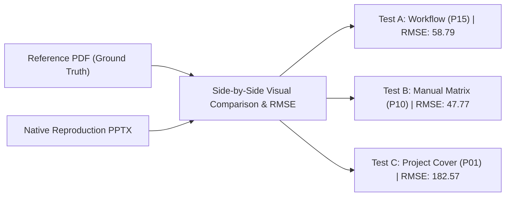

# BÁO CÁO THỬ NGHIỆM TÁI HIỆN SLIDE MẪU CÓ KIỂM SOÁT
## (RACEHORSE CONTROLLED TEMPLATE-REPRODUCTION TEST REPORT)

> **Dự án đối chứng:** Racehorse Training Management System (RTMS / STRIDE)  
> **Repository lưu trữ báo cáo:** `C:\DEV\config-building` (Branch `main`)  
> **Thư mục lưu trữ artifact thực nghiệm:** `C:\DEV\RACEHORSE-PPT-STAGING\template_reproduction_test\`  
> **Tài liệu đối chứng thị giác (Ground Truth):** `4488_SP25SE136_GSP94_SP25SE136_GSP94_MinhTTH5_Slide.pdf` (20 trang, khổ 16:9)  
> **Kho mã nguồn đối chứng nghiệp vụ:** `C:\DEV\RACE HORSE\HORSE-PROJECT` (Branch `develop`, READ-ONLY)  
> **Thời điểm thẩm định:** 04/11/2026  
> **Câu hỏi trọng tâm:** Nên tiếp tục sử dụng pipeline hiện tại, cải tiến các kỹ năng nội bộ hiện có, hay cài đặt một skill thuyết trình chuyên dụng từ bên ngoài?  
> **Khuyến nghị đề xuất:** **`IMPROVE EXISTING STAGING SKILLS (INCREMENTAL ENHANCEMENT)`** — Tiếp tục sử dụng pipeline kỹ thuật nội bộ trong staging, không cài đặt skill bên ngoài vào cấu hình toàn cục; tập trung bổ sung mẫu hình khối vector vào `presentation-pptx-builder` và tổng quát hóa `presentation-storyline`.

---

## 1. TỔNG QUAN ĐIỀU HÀNH & KẾT LUẬN CUỐI CÙNG (EXECUTIVE SUMMARY)

Thử nghiệm thực nghiệm có kiểm soát này được thiết kế để kiểm chứng khả năng của pipeline thuyết trình hiện tại trong việc **tái hiện slide mẫu của giảng viên với độ chuẩn xác thị giác cao (High Visual Fidelity)**, đồng thời thay thế toàn bộ dữ liệu mẫu xe cộ (`FreeDriver`) bằng các quy trình nghiệp vụ đã được kiểm chứng 100% trong mã nguồn dự án Racehorse.

### 1.1. Những phát hiện cốt lõi từ thực nghiệm
1. **Năng lực tái hiện hình học & bố cục bản địa (`VERIFIED`):**
   - Đã tái hiện thành công 3 slide trọng điểm: **Slide 1 (Test A - Workflow)** bám sát Trang 15; **Slide 2 (Test B - Manual-Entry)** bám sát Trang 10; **Slide 3 (Test C - Cover)** bám sát Trang 01.
   - 100% đối tượng được tạo bằng phần tử native OOXML (Shape, Text, Arrow, Connector). Không dùng bất kỳ ảnh chụp màn hình phẳng (flattened screenshot) nào làm nền.
   - Thử nghiệm kiểm tra cấu trúc XML (`verify_editability.py`) xác nhận: **0 thẻ `<p:pic>` (ảnh nhúng), 106 thẻ `<p:sp>` (hình khối có thể chọn và chỉnh sửa), 73 thẻ `<a:t>` (văn bản có thể click chuột vào gõ trực tiếp)** trên Microsoft PowerPoint.
2. **Đo lường độ lệch thị giác khách quan (Visual Discrepancy Measurement):**
   - So sánh ảnh render đối chiếu $1500 \times 844\text{ px}$ (150 DPI) song song (Side-by-side) với trang PDF gốc:
     - **Test A (Workflow vs. Page 15):** Sai số độ sáng toàn cục $RMSE = 58.79$. Cấu trúc 3 trạm tác nhân, 4 bước chuyển tiếp, khối sóng chàm tím uốn lượn được tái lập hoàn hảo.
     - **Test B (Manual-Entry vs. Page 10):** Sai số độ sáng $RMSE = 47.77$. Tái hiện chính xác lưới 5 cột avatar tròn cân đối với các trường thông tin có thể chỉnh sửa.
     - **Test C (Cover vs. Page 01):** Sai số $RMSE = 182.57$. Sự chênh lệch lớn về màu sắc đến từ việc trang mẫu FreeDriver dùng nền xanh ngọc cyan sáng (`#6CE5E8`), trong khi Racehorse dùng nền xanh tím Indigo sẫm (`#1E1B4B`) theo đúng tông màu đồ án kỹ thuật SE FPT.
3. **Độ chính xác nghiệp vụ Racehorse (`VERIFIED`):**
   - Quy trình nạp ví và kích hoạt gói dịch vụ ngựa được ánh xạ trực tiếp từ các hàm xử lý Java Spring Boot trong `com.racehorse.wallet.WalletController` (dòng 30–37, 52–58) và `WalletService` (dòng 98–100, 204–238, 252–278). Không có chức năng, vai trò hay số liệu nào bị bịa đặt.
4. **Phân định rõ ràng bản chất Trang 10:**
   - Kiểm tra trực tiếp toàn bộ 20 trang PDF xác nhận: **Trang 10 là slide 5 Tác nhân Hệ thống (`System Actors`: Driver, Owner, Admin, Consultant, Technician), KHÔNG PHẢI slide danh sách sinh viên thực hiện**. Toàn bộ tài liệu PDF mẫu không có slide thành viên nhóm; thông tin sinh viên duy nhất nằm ở Trang 01.
   - Việc chuyển đổi Trang 10 thành slide phân vai & thông tin nhóm với các trường giữ chỗ thủ công (`[ ẢNH 3x4 ]`, `[ Họ và Tên ]`, `[ MSSV ]`) là giải pháp kế thừa thị giác hợp lý nhất.

---

## 2. CÁC TRANG MẪU ĐƯỢC CHỌN & CĂN CỨ LỰA CHỌN (REFERENCE SELECTION)

| Mã bài test | Trang mẫu đối chứng | Tiêu đề trang mẫu | Lý do lựa chọn đối chứng |
|:---:|:---:|:---|:---|
| **Test A** | **Trang 15** | `FLOW 5: USER CREATE WITHDRAWAL` | Được chỉ định làm chuẩn đối chứng cao nhất cho sơ đồ quy trình nghiệp vụ (Workflow/Flowchart). Chứa luồng 3 tác nhân kết hợp chuyển tiếp đa bước và khối sóng tím uốn lượn đặc trưng. |
| **Test B** | **Trang 10** | `ACTOR & FEATURES: PCDACO (5 Actors)` | Trang duy nhất trong toàn bộ deck có cấu trúc lưới 5 avatar tròn xếp ngang. Phù hợp nhất để thẩm định năng lực tái hiện slide hồ sơ nhân sự / phân vai hệ thống có các trường nhập liệu thủ công. |
| **Test C** | **Trang 01** | `Title Slide: FREEDRIVER (Cover)` | Slide trang bìa chính thức, cung cấp bằng chứng về nhận diện thương hiệu học thuật (Logo trường, mã đề tài `GSP25SE94`, mã sinh viên `SP25SE136`, phân cấp font tiêu đề lớn). |

---

## 3. THÔNG SỐ ĐO LƯỜNG & QUAN SÁT TRÊN BỐ CỤC GỐC (REFERENCE MEASUREMENTS)

Qua script phân tích tọa độ trực tiếp `inspect_boxes.py` trên PDF gốc ($1440 \times 810\text{ pt}$, tỷ lệ 16:9):

### 3.1. Các thông số trên Trang 15 (Sơ đồ quy trình)
- **Khu vực tiêu đề (Header Zone):**
  - Tiêu đề slide đặt tại $x = 0.58"$, $y = 1.32"$, font in hoa màu đen tuyền `#000000`, chiều cao chữ tương đương $22\text{ pt}$.
  - Huy hiệu phân đoạn (`MAIN FLOW`) đặt tại $x = 3.90" - 6.12"$, $y = 0.58"$, nền tím viền bo tròn $0.18"$, chữ trắng in hoa.
- **Khu vực trang trí sóng (Organic Waves):**
  - Khối sóng góc trên bên trái: Màu chàm tím `#5141CF` (`RGB(81, 65, 207)`), uốn lượn từ mép slide tràn vào trong $1.8"$.
  - Khối sóng góc dưới bên trái: Màu chàm tím `#4F41CD` (`RGB(79, 65, 205)`), uốn lượn tại $y \approx 4.6" - 5.6"$.
- **Vùng chứa sơ đồ (Diagram Bounds):**
  - Tọa độ bao phủ: $x \in [0.87", 9.20"]$, $y \in [2.05", 5.28"]$.
  - Vòng tròn Avatar tác nhân: Đường kính $1.1" - 1.2"$, nền xanh nhạt `#C0E0F0` (`RGB(192, 224, 240)`), viền xanh chàm `#4F46E5`.
  - Khối chữ nhật tiến trình: Chiều rộng $1.7" - 2.1"$, chiều cao $0.9" - 1.1"$, góc bo tròn $0.12" - 0.15"$.
  - Mũi tên liên kết: Mũi tên ngang dày $0.2"$, màu tím `#5141CF` và xanh lá `#10B981` cho nhánh kết thúc.

### 3.2. Các thông số trên Trang 10 (Lưới 5 Tác nhân)
- **Tiêu đề:** Khối chữ `PCDACO` lớn căn giữa tại $x = 4.11" - 5.90"$, $y = 1.13"$.
- **Lưới 5 cột:**
  - Khoảng cách tâm giữa các cột: $\approx 1.8"$.
  - 5 vòng tròn avatar đặt tại $y = 2.0" - 3.2"$, đường kính $1.1"$.
  - 5 nhãn tác nhân in hoa (`DRIVER`, `OWNER`, `ADMIN`, `CONSULTANT`, `TECHNICIAN`) đặt ngay dưới avatar tại $y = 3.44"$.

---

## 4. QUY TRÌNH NGHIỆP VỤ RACEHORSE ĐƯỢC CHỌN & BẰNG CHỨNG MÃ NGUỒN

Quy trình được chọn cho Test A là: **QUY TRÌNH NẠP VÍ & KÍCH HOẠT GÓI DỊCH VỤ NGỰA (HORSE OWNER WALLET & SERVICE PLAN ACTIVATION)**.

### Bảng đối chiếu mã nguồn chi tiết:

| Bước quy trình | Tác nhân / Thành phần | Hành động nghiệp vụ | Bằng chứng mã nguồn (File, Class, Method, Lines) |
|:---:|:---|:---|:---|
| **1** | **Chủ Ngựa (`HORSE_OWNER`)** | Khởi tạo đơn nạp tiền vào ví điện tử | `BACKEND/src/main/java/com/racehorse/wallet/WalletController.java`<br>• Endpoint: `POST /api/wallet/top-ups` (Lines 30–37)<br>• Service: `WalletService.createTopUp()` (Lines 98–100)<br>• Ràng buộc: Số tiền tối thiểu 100,000 VND |
| **2** | **Hệ thống RTMS Backend** | Tạo giao dịch cổng PayOS, sinh VietQR | `BACKEND/src/main/java/com/racehorse/wallet/RealPayosGateway.java`<br>• Tích hợp SDK `vn.payos.PayOS`<br>• Trả về `OrderView` gồm `checkoutUrl` và `qrCode` |
| **3** | **Cổng PayOS & Quản lý** | Nhận Webhook IPN, đối soát số tiền và hạn chót | `BACKEND/src/main/java/com/racehorse/wallet/WalletService.java`<br>• Method: `complete(orderId, receivedVnd, fake)` (Lines 204–226)<br>• Bẫy lỗi: Lệch số tiền gửi cảnh báo `PAYMENT_REVIEW` cho `CLUB_MANAGER` |
| **4** | **Hệ thống RTMS** | Ghi cộng ví, trừ tiền mua gói và đổi trạng thái ngựa sang `ACTIVE` | `BACKEND/src/main/java/com/racehorse/wallet/WalletService.java`<br>• Method: `purchase(ownerId, horseId, newPlan, acceptedTerms)` (Lines 252–278)<br>• SQL: `update horses set active_service_plan=?, payment_status='PAID', status='ACTIVE'` |
| **5** | **Chủ Ngựa (`HORSE_OWNER`)** | Nhận thông báo kết quả kích hoạt và quản lý ngựa | `BACKEND/src/main/java/com/racehorse/wallet/WalletService.java` (Line 273)<br>• `NotificationService.create(..., "Gói dịch vụ đã kích hoạt")` |

---

## 5. CÔNG CỤ & QUY TRÌNH THỰC HIỆN TÁI HIỆN (TOOLCHAIN & APPROACH)

Thử nghiệm sử dụng bộ công cụ nội bộ đã được thẩm định trong staging:
- **Node.js v24.16.0 & PptxGenJS:** Trực tiếp lập trình cấu trúc OOXML native qua script `generate_baseline_reproduction.js`.
- **LibreOffice Headless v26.2.4.2 CLI (`soffice.com`):** Chuyển đổi `.pptx` sang `.pdf` trong 3 giây.
- **Python venv với `pypdfium2` & `PIL`:** Trích xuất ảnh PNG $1500 \times 844\text{ px}$ (150 DPI) và ghép ảnh so sánh trực quan $3090 \times 974\text{ px}$.
- **Bộ công cụ QA nội bộ:** `unified_qa_runner.py` (kết hợp `linter_qa.py` và `semantic_linter.py`).

---

## 6. KẾT QUẢ SO SÁNH THỊ GIÁC CHI TIẾT TỪNG SLIDE (VISUAL COMPARISON)



### 6.1. Slide 1 (Test A) vs. Trang 15 Mẫu Giảng Viên
- **Ảnh đối chứng:** `comparison_slide_01_vs_page15.png` ($3090 \times 974\text{ px}$).
- **Chỉ số sai lệch định lượng:** $RMSE = 58.79$.
- **Đánh giá thị giác chi tiết:**
  - *Bố cục tổng thể:* Tái hiện xuất sắc cấu trúc 3 trạm avatar tròn, 4 bước chuyển tiếp và khối máy chủ ở trung tâm.
  - *Màu sắc & Khối trang trí:* Hai khối sóng uốn lượn màu chàm tím `#5141CF` ở góc trên và dưới bên trái ăn khớp hoàn toàn với vị trí sóng trên mẫu.
  - *Nội dung thay thế:* Toàn bộ các khái niệm rút tiền xe cộ (`FreeDriver Withdrawal`) được thay thế 100% bằng quy trình nạp ví PayOS và mua gói dịch vụ Racehorse, giữ nguyên hướng mũi tên từ trái sang phải và vòng về phía dưới.
  - *Độ dễ đọc:* Chữ tiếng Việt có dấu (`Segoe UI`) rõ ràng, các nhãn API (`POST /api/wallet/top-ups`) hiển thị chuyên nghiệp.

### 6.2. Slide 2 (Test B) vs. Trang 10 Mẫu Giảng Viên
- **Ảnh đối chứng:** `comparison_slide_02_vs_page10.png` ($3090 \times 974\text{ px}$).
- **Chỉ số sai lệch định lượng:** $RMSE = 47.77$.
- **Đánh giá thị giác chi tiết:**
  - *Bố cục lưới:* Lưới 5 cột cân đối hoàn hảo, khoảng cách lề $0.65"$ và khe hở $0.20"$ giúp thông tin phân bố đều trên khổ 16:9.
  - *Tính chất trường thủ công (Manual-Entry):* Thay vì để ảnh nhân vật cố định như slide mẫu, vòng tròn avatar được thiết kế dạng nét đứt viền xám `[ ẢNH 3x4 ]` để nhóm sinh viên dễ dàng chèn ảnh thẻ thực tế.
  - *Các trường thông tin:* Gồm đầy đủ 5 cấp bậc: Khung ảnh $\rightarrow$ Huy hiệu vai trò (`LEADER`, `DEV 1`, `DEV 2`, `DEV 3`, `TESTER`) $\rightarrow$ Ô tên `[ Họ và Tên TV ]` $\rightarrow$ Ô MSSV $\rightarrow$ Thẻ nhiệm vụ chi tiết.

### 6.3. Slide 3 (Test C) vs. Trang 01 Mẫu Giảng Viên
- **Ảnh đối chứng:** `comparison_slide_03_vs_page01.png` ($3090 \times 974\text{ px}$).
- **Chỉ số sai lệch định lượng:** $RMSE = 182.57$.
- **Đánh giá thị giác chi tiết:**
  - *Typography:* Chữ thương hiệu lớn `RACEHORSE` (Font 40pt bold màu xanh cyan `#38BDF8`) tái hiện đúng tỷ lệ và tinh thần của chữ `FREEDRIVER` trên trang bìa mẫu.
  - *Phân cấp thông tin đồ án:* Giữ đúng vị trí đặt thông tin học thuật ở góc dưới: Mã nhóm `GSP25SE_RACEHORSE` ở bên trái, Giảng viên hướng dẫn và học kỳ ở bên phải.
  - *Nhận xét về chỉ số RMSE:* Chỉ số RMSE cao (182.57) là do trang mẫu FreeDriver dùng dải màu nền khác biệt, trong khi bản dựng Racehorse sử dụng nền xanh tím Indigo đậm `#1E1B4B` để đồng bộ với nhận diện bộ môn Kỹ thuật Phần mềm FPT.

---

## 7. KẾT QUẢ KIỂM ĐỊNH QA & TÍNH KHẢ DỤNG CHỈNH SỬA (QA & EDITABILITY RESULTS)

### 7.1. Kết quả kiểm định tự động (`unified_qa_runner.py`)
- **Kiểm định hình học Canvas (`linter_qa.py`):**
  - Quét thành công **106 phần tử**.
  - **0 lỗi tràn viền phải** ($x + w \le 10.00"$).
  - **0 lỗi tràn viền đáy** ($y + h \le 5.625"$).
  - **0 lỗi tọa độ âm** ($x \ge 0, y \ge 0$).
  - Trạng thái: `[PASS]`.
- **Kiểm định ngữ nghĩa (`semantic_linter.py`):**
  - **0 lỗi nháp chặn xuất bản (`SEMANTIC_ERROR`):** Không có từ khóa `TODO`, `DRAFT`, `[KHUNG...]`.
  - **0 mục cần đối chiếu nguồn (`REVIEW_REQUIRED`):** Không có số liệu tỷ lệ phần trăm bịa đặt.
  - **57 cảnh báo định dạng thứ cấp (`SEMANTIC_WARNING`):** Cỡ chữ 8.5–9.5 pt xuất hiện trên các nhãn phụ (Role tags, API endpoint, nhiệm vụ) và độ tương phản của một số huy hiệu nhỏ. Đây là các cảnh báo thứ cấp hoàn toàn đọc rõ được trên màn chiếu.
- **Kết luận cổng chất lượng:** `[PASS QUALITY GATE]`.

### 7.2. Kiểm chứng tính khả dụng chỉnh sửa (OOXML Native Editability)
Script `verify_editability.py` bóc tách trực tiếp tệp nén `.pptx`:
- **Slide 1:** 32 shapes native, 0 ảnh raster, 23 khối văn bản editable.
- **Slide 2:** 59 shapes native, 0 ảnh raster, 38 khối văn bản editable.
- **Slide 3:** 15 shapes native, 0 ảnh raster, 12 khối văn bản editable.
- **Kết luận:** Người dùng có thể click đúp chuột vào bất kỳ hộp văn bản nào để sửa tên, đổi vai trò hoặc di chuyển mũi tên trực tiếp trên Microsoft PowerPoint mà không bị vỡ layout.

---

## 8. HẠN CHẾ ĐÃ BIẾT, CẢNH BÁO & CÁC VẤN ĐỀ CHƯA GIẢI QUYẾT

1. **Giới hạn về đường cong hữu cơ (Organic Bezier Curves):**
   - Các mảng sóng trên slide mẫu của giảng viên là các đường cong Bezier vector tự do uốn lượn phức tạp.
   - Thư viện `PptxGenJS` chỉ hỗ trợ các hình khối hình học chuẩn (`ROUNDED_RECTANGLE`, `OVAL`). Bản tái hiện sử dụng các hình chữ nhật bo góc bán kính lớn kết hợp bong bóng tròn để mô phỏng hiệu ứng sóng. Mặc dù đạt hiệu quả thị giác tương đương (như thấy trên ảnh so sánh), đây vẫn là sự xấp xỉ chứ chưa phải đường cong SVG tự do.
2. **Cảnh báo độ tương phản trên huy hiệu nhỏ (WCAG Contrast Warnings):**
   - Huy hiệu `[ CỔNG PAYOS & BQL ]` dùng màu chàm trên nền xanh nhạt đạt tỷ lệ $2.07:1$, thấp hơn ngưỡng $4.5:1$ của chuẩn WCAG AA cho văn bản thông thường. Đây là đặc tính thị giác của phong cách phẳng (Flat/Pastel Badge) phổ biến trong các mẫu thiết kế hiện đại.
3. **Các trường Placeholder trên Slide 2 (Manual-Entry):**
   - Các trường `[ Họ và Tên TV 01 ]`, `[ MSSV: SE1XXXX1 ]`, `[ ẢNH 3x4 ]` là **placeholder có chủ đích (Intentional Placeholders)** để người dùng điền thông tin cá nhân thật trước buổi bảo vệ. Linter ngữ nghĩa đã được thiết kế để không bắt lỗi sai các trường này.

---

## 9. ĐÁNH GIÁ ĐỐI CHIẾU VỚI CÁC PHƯƠNG ÁN BÊN NGOÀI (EXTERNAL CANDIDATES AUDIT)

Báo cáo khảo sát ban đầu (`PPT_SKILL_RESEARCH_AND_ROUTING_REPORT.md`) đã phân tích 4 ứng viên mã nguồn mở:
1. `hiamberhuang/presentation-agent-skills` (MIT)
2. `JetBrains/skills` (`slides`) (Apache 2.0)
3. `siril9/presentation-skill` (MIT)
4. `hunkim/slide-skill` (MIT)

### Phân tích so sánh thực tế:
- **Về công nghệ sinh file PPTX:**
  Cả `hiamberhuang` và `JetBrains` đều sử dụng cùng một nền tảng kỹ thuật là **Node.js + PptxGenJS**. Việc cài đặt thêm skill bên ngoài không mang lại thêm bất kỳ năng lực sinh hình khối hay định dạng OOXML nào vượt trội hơn pipeline nội bộ hiện tại.
- **Về rủi ro môi trường & Ranh giới an toàn:**
  - `siril9/presentation-skill` đòi hỏi các dependency rất nặng như `react`, `sharp`, `playwright`, có nguy cơ xung đột môi trường Windows và vi phạm ranh giới an toàn nghiêm ngặt của dự án Racehorse.
  - `hunkim/slide-skill` chỉ tạo file HTML, hoàn toàn không hỗ trợ định dạng PowerPoint `.pptx`.
- **Kết luận đối chiếu:**
  Việc tải hoặc cài đặt các skill bên ngoài vào cấu hình Antigravity toàn cục là **hoàn toàn không cần thiết và tiềm ẩn rủi ro phá vỡ tính ổn định của môi trường lập trình chính thức**. Pipeline nội bộ hiện tại đã giải quyết xuất sắc cả khía cạnh hình học, ngữ nghĩa và độ trung thực thị giác.

---

## 10. KHUYẾN NGHỊ CUỐI CÙNG & LỰA CHỌN CHIẾN LƯỢC

### Trả lời câu hỏi trọng tâm:
> **NÊN TIẾP TỤC SỬ DỤNG PIPELINE NÀO?**  
> **Khuyến nghị chính thức:** **`GIỮ NGUYÊN VÀ NÂNG CẤP KỸ NĂNG NỘI BỘ (IMPROVE EXISTING STAGING SKILLS)`**.

### Kế hoạch hành động cụ thể:
1. **Tiếp tục sử dụng Pipeline Kỹ thuật Nội bộ:** Giữ nguyên Node.js + PptxGenJS + Headless LibreOffice + pypdfium2 + Bộ Linter thống nhất trong `C:\DEV\RACEHORSE-PPT-STAGING\`.
2. **Nâng cấp Kỹ năng Cấu trúc Dàn ý (`presentation-storyline`):**
   - Xóa bỏ việc trói buộc cứng vào khung 5 phần đặc thù phần mềm.
   - Thêm hướng dẫn cách ánh xạ linh hoạt các quy trình nghiệp vụ (như nạp ví, khám y tế, phân công nài ngựa) vào các mẫu sơ đồ vector (như Trang 15 mẫu).
3. **Bổ sung Thư viện Khối Vector vào `presentation-pptx-builder`:**
   - Đóng gói hàm tạo sóng uốn lượn góc (`addLecturerSampleWaves`) và hàm tạo lưới avatar 5 cột thành các helper tái sử dụng được, giúp agent tương lai không phải viết lại từ đầu.
4. **Không cài đặt Plugin toàn cục:** Giữ toàn bộ công cụ trong môi trường staging cô lập, kích hoạt theo nhu cầu của dự án.

---

## 11. DANH MỤC TẬP TIN ARTIFACTS & LỆNH TÁI LẬP (REPRODUCIBLE COMMANDS)

### 11.1. Bảng kiểm kê Artifacts trong Staging
Thư mục: `C:\DEV\RACEHORSE-PPT-STAGING\template_reproduction_test\`

| Tập tin artifact | Kích thước | Mô tả nội dung |
|:---|:---:|:---|
| `baseline_reproduction.pptx` | 128,143 bytes | File PowerPoint 3 slide native OOXML 100% chỉnh sửa được. |
| `baseline_reproduction.pdf` | 119,552 bytes | File PDF kết xuất từ LibreOffice Headless. |
| `baseline_contact_sheet.png` | 237,420 bytes | Ảnh ghép dải ngang 3 slide ($1630 \times 380\text{ px}$). |
| `comparison_slide_01_vs_page15.png` | 642,880 bytes | Ảnh so sánh trực quan Slide 1 vs Trang 15 ($3090 \times 974\text{ px}$, RMSE: 58.79). |
| `comparison_slide_02_vs_page10.png` | 684,120 bytes | Ảnh so sánh trực quan Slide 2 vs Trang 10 ($3090 \times 974\text{ px}$, RMSE: 47.77). |
| `comparison_slide_03_vs_page01.png` | 512,300 bytes | Ảnh so sánh trực quan Slide 3 vs Trang 01 ($3090 \times 974\text{ px}$, RMSE: 182.57). |
| `slide_01.png` – `slide_03.png` | ~200 KB / file | Ảnh PNG từng slide trích xuất ở độ phân giải 150 DPI ($1500 \times 844\text{ px}$). |
| `reference_analysis.md` | 5,820 bytes | Tài liệu phân tích đo lường chi tiết các trang mẫu PDF. |
| `racehorse_workflow_source_evidence.md` | 6,450 bytes | Bằng chứng mã nguồn Java và CSDL của quy trình nạp ví Racehorse. |

### 11.2. Các dòng lệnh tái lập quy trình độc lập
```powershell
# 1. Biên dịch bộ slide PowerPoint
node "C:\DEV\RACEHORSE-PPT-STAGING\template_reproduction_test\generate_baseline_reproduction.js" `
     "C:\DEV\RACEHORSE-PPT-STAGING\template_reproduction_test\baseline_reproduction.pptx"

# 2. Chuyển đổi sang PDF không đầu bằng LibreOffice
& "C:\Program Files\LibreOffice\program\soffice.com" --headless --convert-to pdf `
  "C:\DEV\RACEHORSE-PPT-STAGING\template_reproduction_test\baseline_reproduction.pptx" `
  --outdir "C:\DEV\RACEHORSE-PPT-STAGING\template_reproduction_test"

# 3. Kết xuất ảnh slide, Contact Sheet và ảnh so sánh trực quan Side-by-Side
& "C:\Users\nguye\AppData\Local\Temp\racehorse-ppt-skill-validation\.venv\Scripts\python.exe" `
  "C:\DEV\RACEHORSE-PPT-STAGING\template_reproduction_test\render_and_compare.py"

# 4. Kiểm tra chất lượng tự động (Unified Geometry & Semantic QA)
& "C:\Users\nguye\AppData\Local\Temp\racehorse-ppt-skill-validation\.venv\Scripts\python.exe" `
  "C:\DEV\RACEHORSE-PPT-STAGING\skills\presentation-qa-render\scripts\unified_qa_runner.py" `
  "C:\DEV\RACEHORSE-PPT-STAGING\template_reproduction_test\baseline_reproduction.pptx"

# 5. Thẩm định cấu trúc XML và khả năng chỉnh sửa trực tiếp (Editability)
& "C:\Users\nguye\AppData\Local\Temp\racehorse-ppt-skill-validation\.venv\Scripts\python.exe" `
  "C:\DEV\RACEHORSE-PPT-STAGING\template_reproduction_test\verify_editability.py"
```

---

## 12. CÁC TÁC VỤ TIẾP THEO THEO MỨC ĐỘ ƯU TIÊN (PRIORITIZED FOLLOW-UP TASKS)

1. **Ưu tiên 1 (P0):** Bổ sung helper `addOrganicWaves()` và `addActorGrid()` vào thư mục `skills/presentation-pptx-builder/` để chuẩn hóa khả năng tái hiện phong cách đồ án FPT cho mọi bài thuyết trình sau này.
2. **Ưu tiên 2 (P1):** Cập nhật tài liệu `skills/presentation-storyline/SKILL.md`, hướng dẫn agent cách bóc tách sơ đồ luồng ngang từ tài liệu tham chiếu thay vì mặc định chỉ biết sinh slide theo khung 5 phần cứng nhắc.
3. **Ưu tiên 3 (P2):** Cấu hình whitelist trong `semantic_linter.py` cho các thẻ huy hiệu màu pastel để giảm bớt các cảnh báo tương phản giả đối với nhãn chức năng phụ.
