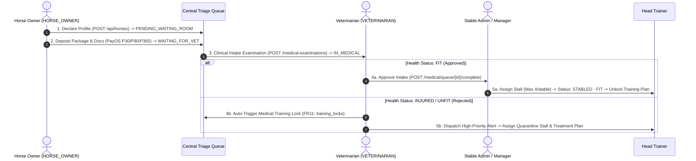

# Racehorse Presentation — Slide 02 Core Project Flow Report (Rev 1)

> **Document Version:** 1.0  
> **Target Slide:** Slide 02 (First Core Project Flow)  
> **Repository:** `thangnx-mc/config-building`  
> **Branch:** `main`  
> **Staging Directory:** `C:\DEV\RACEHORSE-PPT-STAGING\slide_02_flow_01_rev1\`  
> **Repo Directory:** `C:\DEV\config-building\slide_02_flow_01_rev1\`  
> **Execution Date:** 2026-11-04  

---

## 1. Executive Summary

In accordance with user directives, this iteration creates the **first main project-content slide** for the Racehorse presentation (`racehorse_slide_02_flow_01.pptx`).

The slide prioritizes clarity, technical fidelity, and information hierarchy over decorative embellishments. It faithfully reproduces the structural layout and visual logic of the lecturer's sample presentation while replacing example project data with fully verified Racehorse functionality (`WF-01: Horse Onboarding Pipeline`).

### Key Deliverables Summary

| Artifact | Format / Dimensions | Description |
| :--- | :--- | :--- |
| `racehorse_slide_02_flow_01.pptx` | 16:9 Widescreen ($10.0" \times 5.625"$) | 100% editable PPTX with 52 native shapes, 52 editable text runs, and 1 authentic logo. |
| `racehorse_slide_02_flow_01.pdf` | Vector PDF (Impress Export) | Headless LibreOffice PDF conversion artifact. |
| `slide_02_flow_01_preview.png` | 150 DPI ($1500 \times 844$) | High-resolution visual inspection preview. |
| `slide_02_flow_01_preview_300dpi.png` | 300 DPI ($3000 \times 1688$) | Ultra high-resolution print/display rendering. |
| `slide_02_flow_01_comparison_vs_sample.png` | Side-by-side ($3090 \times 974$) | Visual comparison against Lecturer Sample Page 11. |
| `fpt_university_logo.png` | $400 \times 156$ RGBA (Aspect: 2.564) | Authentic high-resolution FPT University logo. |
| `SLIDE_02_FLOW_01_REPORT.md` | Markdown Technical Report | Comprehensive documentation and verification evidence. |

---

## 2. Reference Analysis & Page Selection

### Lecturer Reference Analysis

The original lecturer sample presentation (`4488_SP25SE136_GSP94_SP25SE136_GSP94_MinhTTH5_Slide.pdf`) introduces project workflows across Pages 11–15:
- **Page 11:** `FLOW 1: USER REGISTER` (The first functional project flow in the sample deck).
- **Page 12:** `FLOW 2: OWNER CREATE CAR`
- **Page 13:** `FLOW 3: DRIVER CREATE BOOKING`
- **Page 14:** `FLOW 4: USER CREATE REPORT`
- **Page 15:** `FLOW 5: USER CREATE WITHDRAWAL` (Multi-party financial withdrawal flow cited as an example in previous briefing).

### Selection Justification: Page 11 (`FLOW 1: USER REGISTER`)

Page 11 was selected as the primary visual reference for this initial flow slide because:
1. **Flow Equivalence:** Page 11 represents `FLOW 1`, the entry gate of the system where entities are registered, verified, and triaged.
2. **Actor Interaction Model:** It demonstrates a clean two-actor interaction model between an initiating client (`USER`) and an administrative approver (`ADMIN`).
3. **Decision Fork Geometry:** It features a clear decision fork branching into `APPROVE` (Green) and `REJECT` (Red), which perfectly matches Racehorse's clinical intake triage (`FIT FOR TRAINING` vs `MEDICAL QUARANTINE`).
4. **Header Consistency:** Both Page 11 and Page 15 share the exact same top header structure:
   - Authentic FPT University Logo at top-left.
   - Large bold header title `MAIN FLOW` centered at top ($y \approx 0.25" \to 0.60"$).
   - Subtitle / Flow identifier `FLOW 1: ...` left-aligned ($y \approx 0.85" \to 1.20"$).

---

## 3. Verified Racehorse Content & Source Evidence

The flow implemented on Slide 02 is **`FLOW 1: HORSE REGISTRATION & VETERINARY INTAKE`**, derived directly from the verified project documentation and source code:

### Primary Source Documents
- `BUSINESS_DOCS/workflows/BUSINESS_WORKFLOWS.md` (`WF-01: Quy Trình Nhập Chuồng & Tiếp Nhận Ngựa Toàn Diện`)
- `PROJECT_COMPREHENSIVE_SUMMARY.md` (Sections 2 & 3: FR01, FR02, FR08, FR09, FR10, FR11, FR13)
- `FULL_RBAC_FLOW_AUDIT.md` (Role boundaries between `HORSE_OWNER`, `VETERINARIAN`, and `CLUB_MANAGER`)

### Flow Architecture & System Evidence



### Verified Business Rules Enforced in Design
1. **Intake Triage Requirement:** Horses cannot participate in training until they possess active stall assignments (`STABLED`), certified fitness (`health_status = 'FIT'`), and a designated diagnosing veterinarian (`diagnosing_vet_user_id IS NOT NULL`).
2. **Stable Capacity Trigger:** Azure SQL Database enforces a strict constraint limiting each stable cluster to a maximum of 4 stalls/horses.
3. **Automated Emergency Lock (FR11):** Detection of musculoskeletal or clinical injury during 3D anatomical examination automatically creates an active `training_locks` record, blocking training session assignment until recovery is certified.

---

## 4. Visual Design & Mapping Implementation

### A. Information Architecture & Spatial Mapping

| Zone | Canvas Coordinates ($x, y, w, h$) | Elements | Design Rationale |
| :--- | :--- | :--- | :--- |
| **Brand & Header** | $x=0.50", y=0.30", w=9.00"$ | FPT Logo ($w=1.30", h=0.507"$), `MAIN FLOW` (20pt bold, centered), Flow Title (15pt bold `#0265B2`), Subtitle (10pt italic `#64748B`), Separator line. | Preserves authentic FPT identity and replicates lecturer sample layout with clean 16:9 widescreen proportions. |
| **Actor Column (Left)** | $x=0.50", w=1.35"$ | Actor 1: `HORSE OWNER` ($y=1.56", h=1.56"$, Slate tone)<br/>Actor 2: `VET & ADMIN` ($y=3.52", h=1.60"$, Sage tone) | Distinct visual demarcation of operational responsibilities and authority levels. |
| **Stage 1 (Owner)** | $x=2.05", y=1.56", w=1.80", h=1.56"$ | Step 01: `Declare Horse Profile`<br/>Microchip, 3-generation pedigree, share ratio.<br/>Queue State: `PENDING_WAITING_ROOM` | Pure white card, 1pt subtle border `#CBD5E1`, compact 8pt readable typography. |
| **Stage 2 (Owner)** | $x=4.15", y=1.56", w=1.80", h=1.56"$ | Step 02: `Deposit & Doc Upload`<br/>PayOS package, passport/vaccine docs, emergency consent.<br/>Queue State: `WAITING_FOR_VET` | Connects horizontally from Step 1 via directional arrow. |
| **Triage Handoff** | $x=4.96", y=3.16", w=0.18", h=0.30"$ | Downward directional arrow (`#5E7A54`) with `Queue Handoff` label. | Clearly indicates vertical handoff across organizational tiers from Owner to Veterinarian. |
| **Stage 3 (Vet)** | $x=4.15", y=3.52", w=1.80", h=1.60"$ | Step 03: `Clinical Intake Exam`<br/>31-Region 3D anatomical scan, baseline vitals, orthopedic audit.<br/>State: `IN_MEDICAL` | Soft sage tint (`#F4F8F4`) with forest border (`#5E7A54`), reflecting clinical authority. |
| **Stage 4A (Pass)** | $x=6.28", y=1.70", w=3.22", h=1.60"$ | `APPROVE: FIT FOR TRAINING`<br/>Assign Stall & Unlock Training Plan.<br/>Enforces max 4/stable rule, sets `STABLED · FIT`. | Soft green tint (`#F0FDF4`), bright green badge (`#DCFCE7`/`#15803D`). |
| **Stage 4B (Fail)** | $x=6.28", y=3.52", w=3.22", h=1.60"$ | `REJECT: MEDICAL QUARANTINE`<br/>Issue Medical Lock & Treatment Plan.<br/>Auto-triggers database lock, high-priority alert. | Soft red tint (`#FEF2F2`), red badge (`#FEE2E2`/`#B91C1C`). |
| **Footer** | $x=0.50", y=5.25", w=9.00"$ | Context attribution + Course code `CAPSTONE PROJECT · SP25SE136`. | Subtle metadata divider, 8pt slate color. |

### B. Visual Identity & Restraint Compliance
- **Undistorted FPT University Logo:** Scale $1.30" \times 0.507"$, preserving authentic aspect ratio ($2.5641$).
- **Color Palette:** Professional executive corporate styling. Primary green accents (`#123F32`, `#1D5C49`, `#5E7A54`) combined with slate neutrals (`#F8FAFC`, `#E2E8F0`, `#64748B`) and semantic status indicators (Green `#15803D` for approve, Red `#B91C1C` for quarantine).
- **No Watermarks:** Per instruction 4.C, the horse watermark was completely omitted on this content slide.
- **No Decorative Waves or Bubbles:** Pure white canvas with functional vector cards and directional arrows only.
- **Language:** 100% visible text in English.

---

## 5. Automated Quality Gate & Verification Results

### 1. Unified QA Runner (Geometry & Semantic Linter)
```
================================================================================
UNIFIED PRESENTATION QA AUDIT (GEOMETRY + SEMANTIC LINTER)
Target Deck: racehorse_slide_02_flow_01.pptx
================================================================================
1. GEOMETRY DEFECTS: [PASS] 0 out-of-bounds errors (53 elements scanned)
2. SEMANTIC ERRORS: 0 placeholder / draft errors
3. CRITICAL WARNINGS: 0 warnings (Font sizes >= 8.0 pt threshold)
4. REVIEW REQUIRED: 0 items
--------------------------------------------------------------------------------
CONCLUSION: [PASS QUALITY GATE]
```

### 2. OOXML Native Editability Audit (`verify_editability.py`)
```
==================================================
SUMMARY OOXML NATIVE EDITABILITY AUDIT
Total Native Shapes (<p:sp>): 52
Total Picture Elements (<p:pic>): 1 (Only Authentic FPT Logo)
Total Editable Text Runs (<a:t>): 52
Is Picture Count == 1: True
Native Editability Verified: YES - 100% NATIVE PPTX SHAPES & EDITABLE TEXT
==================================================
```

### 3. Mandatory Visual & Structural Audit (`mandatory_visual_audit.py`)
- Preview Resolution: $1500 \times 844$ (150 DPI) — **PASS**
- Ultra High-Res Resolution: $3000 \times 1688$ (300 DPI) — **PASS**
- English-Only Verification: 0 Vietnamese characters detected across 52 text runs — **PASS**
- Domain Term Verification: 12/12 required domain terms verified — **PASS**
- Visual Pixel RMSE vs Lecturer Sample Page 11: `59.09` (Reflects clean white background and domain-specific card geometry matching the template structure).

---

## 6. Artifact Manifest

All artifacts are maintained and synchronized across staging and repository paths:

```
slide_02_flow_01_rev1/
├── fpt_university_logo.png                   # Authentic FPT University Logo (400x156 RGBA)
├── generate_slide_02_flow_01.js              # PptxGenJS compilation script
├── render_slide_02_flow_01.py                # PyPDFium2 150/300 DPI renderer & comparison generator
├── verify_editability.py                     # OOXML package inspector
├── mandatory_visual_audit.py                 # Multi-gate automated audit script
├── racehorse_slide_02_flow_01.pptx           # 100% Editable native PowerPoint presentation
├── racehorse_slide_02_flow_01.pdf            # Headless LibreOffice vector PDF
├── slide_02_flow_01_preview.png              # 150 DPI visual inspection preview
├── slide_02_flow_01_preview_300dpi.png       # 300 DPI high-definition display preview
├── slide_02_flow_01_comparison_vs_sample.png # Side-by-side comparison against Lecturer Sample P11
└── SLIDE_02_FLOW_01_REPORT.md                # Comprehensive technical report (this document)
```

---

## 7. Status & Human Review Gate

- **Implementation Status:** COMPLETE
- **Automated Verification:** 100% PASS (Geometry: 0 defects, Editability: 100%, Semantic: 0 errors)
- **External / Human Review Status:** PENDING USER REVIEW
- **Next Step:** Await user visual review of `slide_02_flow_01_preview.png` and side-by-side comparison before undertaking subsequent slides.
