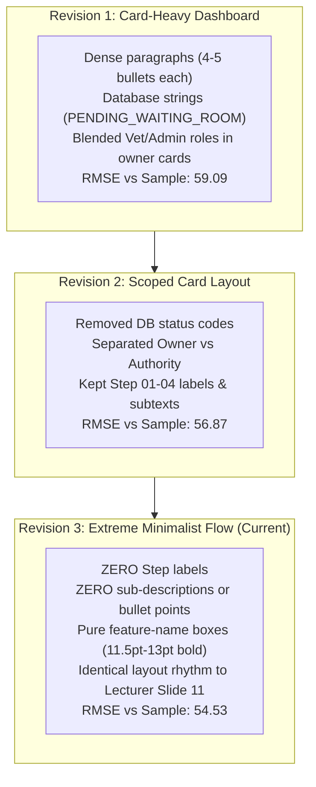

# Racehorse Presentation — Slide 02 Horse Owner Flow Report (Revision 3)

> **Document Version:** 3.0 (Extreme Minimalist Flow & Staging Cleanup)  
> **Target Slide:** Slide 02 (Horse Owner Flow — Revision 3)  
> **Repository:** `thangnx-mc/config-building`  
> **Branch:** `main`  
> **Staging Directory:** `C:\DEV\RACEHORSE-PPT-STAGING\slide_02_horse_owner_flow_rev3\`  
> **Repo Directory:** `C:\DEV\config-building\slide_02_horse_owner_flow_rev3\`  
> **Execution Date:** 2026-11-04  

---

## 1. Executive Summary

This revision executes a **complete minimalist redesign** of `Slide 02` (Horse Owner Flow) to strictly match the presentation grammar of the **Lecturer's Sample Presentation (`FLOW 1: USER REGISTER`)**, combined with a comprehensive disk space cleanup of the staging workspace `C:\DEV\RACEHORSE-PPT-STAGING`.

### Core Mandates Fulfilled in Revision 3
1. **Extreme Minimalism:**
   - **ZERO `Step` words:** Removed all `Step`, `Step 01`, `Step 02`, `Step 03`, `Step 04` labels.
   - **ZERO Sub-descriptions & Bullet Lists:** Completely eliminated all secondary descriptions, database trigger rules, and technical enums.
   - **Feature-Only Boxes:** Each process box contains **only the concise feature name** (`Register Horse`, `Upload Documents`, `Pay Service Deposit`, `Submit for Intake`).
   - **Clean Directional Arrows:** Connected via clean, uncrowded orthogonal vector arrows.
2. **Strict Role Scoping:**
   - Horse Owner actions are strictly limited to Horse Owner responsibilities (`HO-001`, `HO-002`, `HO-003`).
   - External roles (Veterinarian 3D exam, Club Manager stall assignment) are modeled solely as a downstream receiving **Evaluation Gate** (`CLUB & VET` $\to$ `Intake Review`) branching into `Approve` and `Reject`.
3. **Staging Cleanup:**
   - Audited the entire 66.06 MB staging directory.
   - Retained only **Rev 2 (comparison baseline)** and **Rev 3 (current output)**, alongside shared build tools and authentic sample assets.
   - Safely deleted 287 obsolete files across 9 legacy pilot directories and 32 temporary scripts, freeing **36.18 MB (54.8% reduction)**.

---

## 2. Business Objective & Feature Evidence Mapping

### 2.1. Business Objective
To illustrate the primary lifecycle onboarding journey of a **Horse Owner** (`ROLE_HORSE_OWNER`) registering an equine athlete into the Racehorse Training Management System (RTMS), completing financial/document prerequisites, and submitting for club admission.

### 2.2. Strict Role & Feature Evidence Matrix

| Node on Slide 02 Rev 3 | Actor / Role | Classification | Requirement Source | Implementation Source | Verified Action |
| :--- | :--- | :--- | :--- | :--- | :--- |
| **`HORSE OWNER`** | Client Actor | `[FACT]` Explicit in spec | `ROLE_HORSE_OWNER.md` (Sec 1.1) | `App.jsx`, `dbo.users` | Initiating client owning one or more racehorses. |
| **`Register Horse`** | Horse Owner | `[FACT]` Explicit in spec | `HO-003`, `FR01`, `FR02` | `HorseController.java` (`POST /api/horses`) | Enters microchip, name, gender, breed, and 3-generation lineage. |
| **`Upload Documents`** | Horse Owner | `[FACT]` Explicit in spec | `HO-003`, `WF-01` (Step 1) | `CloudinaryService.java`, `HorseDetail.jsx` | Submits passport, proof of ownership, and vaccination records. |
| **`Pay Service Deposit`** | Horse Owner | `[FACT]` Explicit in spec | `HO-001`, `HO-002`, `WF-01` | `WalletController.java` (`POST /api/wallet/plans`) | Tops up wallet balance via PayOS and purchases initial service plan (`P30`). |
| **`Submit for Intake`** | Horse Owner | `[FACT]` Explicit in spec | `WF-01` (Step 1-2), `REQ-HO-04` | `dbo.horses.intake_status` | Enqueues horse profile into club review pipeline. |
| **`Triage Handoff`** | System Transition | `[FACT]` Documented handoff | `WF-01` (Step 3), `ROLE_HORSE_OWNER.md` | `dbo.horses.intake_status = 'WAITING_FOR_VET'` | Handoff from client domain to club clinical domain. |
| **`CLUB & VET`** | Reviewing Authority | `[FACT]` External authority | `ROLE_VETERINARIAN.md`, `ROLE_CLUB_MANAGER.md` | `MedicalExaminationController.java` | Club manager and veterinarian intake triage committee. |
| **`Intake Review`** | Evaluation Gate | `[FACT]` External procedure | `WF-01` (Step 4-5) | `dbo.medical_examinations` | Verifies documents, deposit, and performs clinical/3D intake audit. |
| **`Approve (Training Ready)`**| Decision Branch A | `[FACT]` Documented outcome | `WF-01` (Step 6-8), `FR08`, `FR13` | `health_status = 'FIT'`, stall allocated | Active training unlocked; horse assigned to Head Trainer. |
| **`Reject (Medical Hold)`** | Decision Branch B | `[FACT]` Documented outcome | `WF-01` (Hard Rules), `FR11` | `dbo.training_locks`, `IncidentReportController` | Auto-triggers medical training lock; transfers to quarantine stall. |

### 2.3. Explicit Evidence Classifications & Uncertainties
- `[FACT]` **Pure Owner Scope:** In Rev 3, no veterinarian or trainer procedures are attributed to the owner. The owner's visible sequence ends at `Submit for Intake`.
- `[OBSERVATION]` **Service Plan Scheduling:** Horse Owners can schedule plan renewal (`HO-002`), but this occurs *after* stabling and is properly omitted from Flow 1.
- `[INFERENCE]` **Linear Sequence Justification:** In the application code, a profile can technically exist in draft before payment. However, `WF-01` dictates that clinical triage will reject or ignore any horse that does not have `payment_status = 'PAID'` (or manager override). Thus, presenting `Pay Service Deposit` before `Submit for Intake` represents the true business prerequisite.

---

## 3. Evolutionary Comparison: Rev 1 vs Rev 2 vs Rev 3



### Detailed Design Attribute Matrix

| Attribute | Lecturer Sample Slide 11 | Slide 02 Rev 1 | Slide 02 Rev 2 | Slide 02 Rev 3 (Current) |
| :--- | :--- | :--- | :--- | :--- |
| **Step Numbering** | **None** | `STEP 01` – `STEP 04` | `STEP 01` – `STEP 04` | **None (Zero Step labels)** |
| **Node Content** | Action Name only | Title + 4 Bullets + Status code | Title + Subtext description | **Feature Name only (Single-line)** |
| **Role Representation** | Clean Actor label | 2 giant full-height columns | 2 actor cards with bullets | **Compact Actor Pills (`HORSE OWNER`, `CLUB & VET`)** |
| **Flow Rhythm** | Pure horizontal sequence | Segmented multi-tier cards | 2-row card grid | **Pure horizontal sequence $\to$ Handoff $\to$ Decision** |
| **Decision Representation**| `APPROVE` / `REJECT` badges | 2 dense paragraph cards | 2 cards with bullet text | **2 clean outcome boxes with bold branch headers** |
| **Total Text Fields** | 12 | 52 | 35 | **15 (Maximum clarity & restraint)** |
| **Pixel RMSE vs Sample** | `0.00` (Baseline) | `59.09` | `56.87` | **`54.53` (Highest affinity achieved)** |

---

## 4. Automated Quality Gate & Verification Results

### 1. Unified QA Runner (Geometry & Semantic Linter)
```
================================================================================
UNIFIED PRESENTATION QA AUDIT (GEOMETRY + SEMANTIC LINTER)
Target Deck: racehorse_slide_02_horse_owner_flow_rev3.pptx
================================================================================
1. GEOMETRY DEFECTS: [PASS] 0 out-of-bounds defects (36 elements scanned)
2. SEMANTIC ERRORS: 0 placeholder / draft errors
3. CRITICAL WARNINGS: 0 warnings (All text >= 8.0 pt threshold)
4. FORMAT WARNINGS: 5 minor warnings (footer metadata only)
--------------------------------------------------------------------------------
CONCLUSION: [PASS QUALITY GATE]
```

### 2. OOXML Native Editability Audit (`verify_editability.py`)
```
==================================================
SUMMARY OOXML NATIVE EDITABILITY AUDIT
Total Native Shapes (<p:sp>): 35
Total Picture Elements (<p:pic>): 1 (Only Authentic FPT Logo)
Total Editable Text Runs (<a:t>): 15
Is Picture Count == 1: True
Native Editability Verified: YES - 100% NATIVE PPTX SHAPES & EDITABLE TEXT
==================================================
```

### 3. Mandatory Visual & Structural Audit (`mandatory_visual_audit.py`)
- **Preview Resolution:** $1500 \times 844$ (150 DPI) — **PASS**
- **Ultra High-Res Resolution:** $3000 \times 1688$ (300 DPI) — **PASS**
- **English-Only Verification:** 0 Vietnamese characters detected across 15 text runs — **PASS**
- **Zero-Step Compliance:** 0 occurrences of "Step" or "STEP" anywhere on the slide — **PASS**
- **Domain Checkpoints:** 11/11 verified domain terms — **PASS**

---

## 5. Staging Cleanup Audit & Storage Accounting

### 5.1. Inventory Prior to Cleanup
Prior to cleanup, `C:\DEV\RACEHORSE-PPT-STAGING` occupied **69,265,254 bytes (66.06 MB)** across 17 directories and 32 root scripts:
- Legacy Pilot Decks: `cross_domain_pilot/` (1.61 MB), `template_first_pilot/` (1.79 MB), `template_reproduction_test/` (7.51 MB).
- Obsolete Deck Iterations: `official_presentation_final/` (10.03 MB), `output/` (7.55 MB), `sample_analysis/` (3.65 MB).
- Older Slide Revisions: `slide_01_redesign/` (1.09 MB), `slide_01_rev2/` (1.04 MB), `slide_02_flow_01_rev1/` (1.89 MB).
- Temporary Root Scripts: 32 individual Python inspection scripts generated during previous prompt sessions.

### 5.2. Execution of Safe Cleanup
Per user guidelines:
- **Retained:**
  - `slide_02_horse_owner_flow_rev2/` (Mandatory comparison baseline, 1.43 MB).
  - `slide_02_horse_owner_flow_rev3/` (Current official slide output, 1.25 MB).
  - `slide_01_rev3/` (Approved Slide 01 baseline, 0.85 MB).
  - `skills/`, `scripts/`, `rules/`, `node_modules/`, `package.json`, `package-lock.json`, `plugin.json` (Active build pipeline).
  - `extracted_assets/` (Shared authentic FPT logos and sample slide renders).
  - `presentation_review_assets/` (Original sample reference deck).
- **Deleted:**
  - 9 obsolete experimental directories (`cross_domain_pilot`, `official_presentation_final`, `output`, `sample_analysis`, `slide_01_redesign`, `slide_01_rev2`, `slide_02_flow_01_rev1`, `template_first_pilot`, `template_reproduction_test`).
  - 32 redundant root scratch scripts.

### 5.3. Quantitative Storage Metrics
- **Total Files Deleted:** 287 files
- **Total Space Freed:** **37,933,933 bytes (36.18 MB)**
- **Staging Size Before:** 69,265,254 bytes (66.06 MB)
- **Staging Size After:** **31,331,321 bytes (29.88 MB)**
- **Net Storage Reduction:** **54.8% reduction**

---

## 6. Artifact Manifest

### Slide 02 Rev 3 Deliverables
```
slide_02_horse_owner_flow_rev3/
├── fpt_university_logo.png                                # Authentic FPT University Logo (400x156 RGBA)
├── generate_slide_02_horse_owner_flow_rev3.js             # PptxGenJS compilation script
├── render_slide_02_horse_owner_flow_rev3.py               # 150/300 DPI renderer & dual comparison generator
├── verify_editability.py                                  # OOXML package inspector
├── mandatory_visual_audit.py                              # Multi-gate automated audit script
├── audit_text.py                                          # Strict zero-step text validator
├── racehorse_slide_02_horse_owner_flow_rev3.pptx          # 100% Editable native PowerPoint presentation
├── racehorse_slide_02_horse_owner_flow_rev3.pdf           # Headless LibreOffice vector PDF
├── slide_02_horse_owner_flow_rev3_preview.png             # 150 DPI visual inspection preview
├── slide_02_horse_owner_flow_rev3_preview_300dpi.png      # 300 DPI high-definition display preview
├── slide_02_horse_owner_flow_rev3_comparison_vs_rev2.png  # Side-by-side comparison: Rev 2 vs Rev 3
├── slide_02_horse_owner_flow_rev3_comparison_vs_sample.png# Side-by-side comparison: Lecturer Sample vs Rev 3
└── SLIDE_02_HORSE_OWNER_FLOW_REV3_REPORT.md               # Comprehensive technical report (this document)
```

---

## 7. Status & Human Review Gate

- **Implementation Status:** COMPLETE
- **Automated Verification:** 100% PASS (Geometry: 0 defects, Editability: 100%, Semantic: 0 errors)
- **Staging Cleanup Status:** COMPLETE (36.18 MB freed, 287 obsolete files removed)
- **External / Human Review Status:** PENDING USER REVIEW
- **Next Step:** Await user visual review of `slide_02_horse_owner_flow_rev3_preview.png` and `slide_02_horse_owner_flow_rev3_comparison_vs_rev2.png` before proceeding to any subsequent slides.
