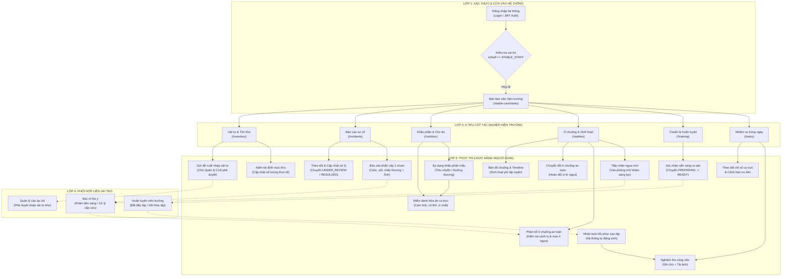

# BÁO CÁO KHÁM PHÁ TÍNH NĂNG & KIẾN TRÚC LUỒNG TÁC NGHIỆP: TÀI KHOẢN NHÂN VIÊN CHUỒNG (STABLE ROLE)
## STABLE ACCOUNT FEATURE DISCOVERY & FLOW PREPARATION REPORT (TASK RH-DRAWIO-01)

> **Dự án:** Racehorse Training & Club Management System (RTMS)  
> **Kho nguồn kiểm tra (Source Repository):** `C:\DEV\RACE HORSE\HORSE-PROJECT` (Branch `develop`, Snapshot HEAD: `e8b3b8f5d316bb390f7848aefd65174bdbc70e6e`)  
> **Kho báo cáo (Reporting Repository):** `https://github.com/thangnx-mc/config-building` (Branch `main`)  
> **Mục tiêu nghiên cứu:** Vai trò tài khoản **Stable** (`STABLE_STAFF` / Nhân viên chuồng)  
> **Tình trạng:** Hoàn tất khám phá (Discovery Phase Complete) — Sẵn sàng cho thiết kế sơ đồ Draw.io  
> **Ngày thực hiện:** 06/11/2026  

---

## 1. TỔNG QUAN TÌNH TRẠNG (EXECUTIVE STATUS)

* `[FACT]` **Danh tính vai trò đích:** Vai trò được yêu cầu khảo sát là **"Stable"**. Trong cơ sở mã nguồn thực tế (cả Backend, Frontend và Database), mã định danh hệ thống chuẩn tắc là **`STABLE_STAFF`**, hiển thị trên giao diện người dùng tiếng Việt là **"Nhân viên chuồng"** (trong các tài liệu nghiệp vụ còn gọi là *Groom*, *Stable Hand*, hoặc *Người chăm sóc*).
* `[FACT]` **Hiện trạng triển khai:** Phân hệ dành cho Nhân viên chuồng đã được hiện thực hóa đầy đủ trên nhánh `develop`, tập trung toàn bộ trong phân hệ điều hành hiện trường **`/stable-care`** (`StableCarePage.jsx`) với 6 thẻ tab chức năng chính và tích hợp chuông thông báo tác nghiệp thời gian thực.
* `[FACT]` **Tổng số tính năng phát hiện:**
  * **15 tính năng được xác minh đầy đủ (Confirmed / Fully Verified):** Được chứng minh đồng thời qua mã nguồn Frontend (UI View, Form, Action), Backend Controller (Spring Security annotations), Service logic và Database schema.
  * **3 tính năng được xác minh một phần (Partially Confirmed):** Backend API và phân quyền đã hỗ trợ hoặc tài liệu SRS có quy định, nhưng giao diện người dùng hiện tại đang ẩn nút bấm trực tiếp hoặc điều hướng gián tiếp.
  * **0 tính năng không rõ ràng (Unclear):** Toàn bộ các API và luồng thao tác đều có mã nguồn đối chiếu rõ ràng.
* `[FACT]` **Quy tắc an toàn mã nguồn:** Kho nguồn `C:\DEV\RACE HORSE\HORSE-PROJECT` được giữ nguyên trạng thái Read-only 100%, không phát sinh bất kỳ chỉnh sửa nào vào mã nguồn ứng dụng hay cấu hình cơ sở dữ liệu.

---

## 2. DANH TÍNH VAI TRÒ & BẰNG CHỨNG XÁC THỰC, PHÂN QUYỀN (STABLE ROLE IDENTITY & AUTHORIZATION EVIDENCE)

### 2.1. Định danh vai trò (Role Identifier & Display Name)
* **Mã vai trò Backend (Role Enum):** `STABLE_STAFF`  
  * *Bằng chứng:* [`BACKEND/src/main/java/com/racehorse/auth/entity/Role.java#L3-L9`](file:///c:/DEV/RACE%20HORSE/HORSE-PROJECT/BACKEND/src/main/java/com/racehorse/auth/entity/Role.java#L3-L9) gồm 5 enum: `CLUB_MANAGER`, `HEAD_TRAINER`, `STABLE_STAFF`, `HORSE_OWNER`, `VETERINARIAN`.
* **Tên hiển thị giao diện Frontend (Display Label):** `"Nhân viên chuồng"`  
  * *Bằng chứng:* [`FRONTEND/src/App.jsx#L19-L22`](file:///c:/DEV/RACE%20HORSE/HORSE-PROJECT/FRONTEND/src/App.jsx#L19-L22): `ROLE_LABELS = { STABLE_STAFF: 'Nhân viên chuồng', ... }`.
* **Nhóm điều hướng thanh bên (Sidebar Navigation Group):** `"VẬN HÀNH HIỆN TRƯỜNG"`  
  * *Bằng chứng:* [`FRONTEND/src/App.jsx#L185`](file:///c:/DEV/RACE%20HORSE/HORSE-PROJECT/FRONTEND/src/App.jsx#L185): `{isStaff && <small className="nav-group">VẬN HÀNH HIỆN TRƯỜNG</small>}`.
* **Cờ nhận diện người dùng tại Frontend:**  
  * `const isStaff = hasAny(user, 'STABLE_STAFF') && !isManager` ([`FRONTEND/src/App.jsx#L133`](file:///c:/DEV/RACE%20HORSE/HORSE-PROJECT/FRONTEND/src/App.jsx#L133)).
  * Trạng thái thanh tiêu đề (Topbar): `"Ca trực chăm sóc chuồng đang hoạt động"` ([`FRONTEND/src/App.jsx#L197`](file:///c:/DEV/RACE%20HORSE/HORSE-PROJECT/FRONTEND/src/App.jsx#L197)).

### 2.2. Cơ chế phân quyền RBAC & Bằng chứng cấp quyền (RBAC Authorities)
Hệ thống sử dụng cơ chế cấp quyền động lai ghép (Hybrid RBAC) kết hợp quyền theo vai trò (`ROLE_<ROLE>`) và quyền động theo phân hệ/hành động (`PERM_<MODULE>_<ACTION>`):
1. **Chuyển đổi JWT sang GrantedAuthorities:**  
   * Bằng chứng: [`BACKEND/src/main/java/com/racehorse/common/config/SecurityConfiguration.java#L83-L103`](file:///c:/DEV/RACE%20HORSE/HORSE-PROJECT/BACKEND/src/main/java/com/racehorse/common/config/SecurityConfiguration.java#L83-L103) nạp `ROLE_STABLE_STAFF` và danh sách quyền từ `userRepository.findGrantedPermissionCodes(userId)`.
2. **Quyền động mặc định được cấp trong Database Seed:**  
   * Bằng chứng: [`DATABASE/09_seed_reference_data.sql#L108-L118`](file:///c:/DEV/RACE%20HORSE/HORSE-PROJECT/DATABASE/09_seed_reference_data.sql#L108-L118) gán cho `STABLE_STAFF`:
     * `('PROFILE', 'VIEW')` $\rightarrow$ `PERM_PROFILE_VIEW` (Xem thông tin hồ sơ, ảnh ngựa, định danh).
     * `('TRAINING', 'VIEW')` $\rightarrow$ `PERM_TRAINING_VIEW` (Xem lịch tập luyện để chuẩn bị dắt ngựa ra sân).
     * `('TRAINING', 'EDIT')` $\rightarrow$ `PERM_TRAINING_EDIT`.
     * `('STABLE_CARE', 'VIEW')` $\rightarrow$ `PERM_STABLE_CARE_VIEW` (Xem ô chuồng, sinh hoạt, nhiệm vụ, dinh dưỡng).
     * `('STABLE_CARE', 'EDIT')` $\rightarrow$ `PERM_STABLE_CARE_EDIT` (Thực hiện nhiệm vụ, điều chuyển chuồng, tiếp nhận phòng chờ, báo cáo sự cố, áp dụng khẩu phần mẫu).
     * `('MEDICAL', 'VIEW')` $\rightarrow$ `PERM_MEDICAL_VIEW` (Xem bản đồ sức khỏe chuồng trại, tình trạng chấn thương).
     * `('INVENTORY', 'VIEW')` $\rightarrow$ `PERM_INVENTORY_VIEW` (Xem danh mục kho vật tư, ngưỡng an toàn).
     * `('INVENTORY', 'EDIT')` $\rightarrow$ `PERM_INVENTORY_EDIT` (Điều chỉnh số lượng kiểm kê, gửi phiếu đề xuất bổ sung hàng, ghi nhận xuất dùng).

### 2.3. Tính độc lập của vai trò & Chồng lấn phân quyền (Role Overlap Analysis)
* `[FACT]` **Tính độc lập:** `STABLE_STAFF` là một vai trò độc lập hoàn toàn với không gian làm việc chuyên biệt cho nhân sự hiện trường.
* `[FACT]` **Ranh giới với Huấn luyện viên trưởng (`HEAD_TRAINER`):** 
  * `HEAD_TRAINER` lập kế hoạch, lên lịch tập luyện, bắt đầu và hoàn thành buổi tập; `STABLE_STAFF` chỉ nhận lịch để chuẩn bị yên cương, xác nhận sẵn sàng (`READY`) và thực thi nhiệm vụ hồi phục sau tập (`SPECIAL` care task).
  * `HEAD_TRAINER` soạn thảo lịch sinh hoạt định kỳ (`daily-routines`); `STABLE_STAFF` chỉ xem để tuân thủ thời gian biểu.
* `[FACT]` **Ranh giới với Bác sĩ thú y (`VETERINARIAN`):** 
  * `VETERINARIAN` khám lâm sàng sàng lọc (`IN_MEDICAL`), chẩn đoán, thiết lập khẩu phần dinh dưỡng chi tiết; `STABLE_STAFF` tiếp nhận ngựa vào phòng chờ khám, nhận ngựa đã khám để phân bổ chuồng, áp dụng khẩu phần mẫu tiêu chuẩn đã được duyệt và điểm danh bữa ăn thực tế.
  * Khi phát hiện ngựa đau ốm, `STABLE_STAFF` chỉ báo cáo sự cố khẩn cấp (`incidents`) để thông báo cho Vet can thiệp y khoa.
* `[FACT]` **Ranh giới với Quản lý câu lạc bộ (`CLUB_MANAGER`):** 
  * `STABLE_STAFF` lập đề xuất bổ sung vật tư khi kho chuồng sắp hết; quyền phê duyệt hoặc từ chối phiếu đề xuất thuộc độc quyền của `CLUB_MANAGER`.
  * `STABLE_STAFF` phân bổ và chuyển chuồng ngựa; việc tạo lập/xóa khu chuồng hoặc mã ô chuồng vật lý thuộc về `CLUB_MANAGER`.

---

## 3. DANH MỤC TÍNH NĂNG TOÀN DIỆN (COMPLETE FEATURE INVENTORY)

Dưới đây là 18 tính năng được tổng hợp logic (không liệt kê endpoint đơn lẻ, gom nhóm theo nghiệp vụ người dùng):

| Feature ID | Feature Name | Frontend Location | Main Action | Backend Evidence | Permission Required | Evidence Source | Confidence |
|---|---|---|---|---|---|---|---|
| **SS-FEAT-01** | Checklist & Nghiệm thu nhiệm vụ chăm sóc ca trực | `/stable-care/tasks` | Xem checklist công việc theo ngày; bấm "Hoàn thành", nhập ghi chú và tải ảnh bằng chứng nghiệm thu; xem ảnh minh chứng | `GET /api/care-tasks`<br>`POST /api/care-tasks/{id}/complete`<br>`GET /api/care-tasks/{id}/photo` | `PERM_STABLE_CARE_VIEW`<br>`ROLE_STABLE_STAFF` & `PERM_STABLE_CARE_EDIT` | [`CareTaskController.java#L38-L109`](file:///c:/DEV/RACE%20HORSE/HORSE-PROJECT/BACKEND/src/main/java/com/racehorse/caretask/controller/CareTaskController.java#L38-L109)<br>[`StableCarePage.jsx#L3181-L3650`](file:///c:/DEV/RACE%20HORSE/HORSE-PROJECT/FRONTEND/src/StableCarePage.jsx#L3181-L3650) | **Confirmed** |
| **SS-FEAT-02** | Giám sát cảnh báo vận hành ca trực | `/stable-care/tasks` | Theo dõi 4 chỉ số ca trực (Tổng việc, Đang chờ, Đã xong, Quá hạn) và khối lưu ý vận hành (sự cố chưa xử lý, vật tư cạn kho); bấm điều hướng nhanh | `GET /api/care-tasks`<br>`GET /api/incidents?status=REPORTED`<br>`GET /api/inventory/items?lowStockOnly=true` | `PERM_STABLE_CARE_VIEW`<br>`PERM_INVENTORY_VIEW` | [`StableCarePage.jsx#L3193-L3361`](file:///c:/DEV/RACE%20HORSE/HORSE-PROJECT/FRONTEND/src/StableCarePage.jsx#L3193-L3361) | **Confirmed** |
| **SS-FEAT-03** | Chuẩn bị & Xác nhận sẵn sàng huấn luyện | `/stable-care/training` | Xem lịch tập của ngựa phụ trách; chuẩn bị yên cương; bấm "Xác nhận sẵn sàng" đưa buổi tập sang trạng thái `READY` mở khóa cho HLV | `GET /api/training-schedules/mine`<br>`PATCH /api/training-schedules/{id}/ready` | `PERM_TRAINING_VIEW` & `ROLE_STABLE_STAFF` | [`TrainingScheduleController.java#L68-L73`](file:///c:/DEV/RACE%20HORSE/HORSE-PROJECT/BACKEND/src/main/java/com/racehorse/training/controller/TrainingScheduleController.java#L68-L73)<br>[`StableCarePage.jsx#L1749-L1980`](file:///c:/DEV/RACE%20HORSE/HORSE-PROJECT/FRONTEND/src/StableCarePage.jsx#L1749-L1980) | **Confirmed** |
| **SS-FEAT-04** | Tiếp nhận & Chăm sóc hồi phục sau buổi tập | `/stable-care/tasks` | Nhận nhiệm vụ hồi phục (`SPECIAL` care task) được sinh tự động khi HLV kết thúc buổi tập; tắm làm mát, chườm đá chân gân, nghiệm thu task | `TrainingScheduleService.finishTraining`<br>`CareTaskService.createRecoveryTask`<br>`POST /api/care-tasks/{id}/complete` | `ROLE_STABLE_STAFF` & `PERM_STABLE_CARE_EDIT` | [`TrainingScheduleService.java#L340-L360`](file:///c:/DEV/RACE%20HORSE/HORSE-PROJECT/BACKEND/src/main/java/com/racehorse/training/service/TrainingScheduleService.java#L340-L360)<br>[`ROLE_STABLE_STAFF.md#L92-L111`](file:///c:/DEV/RACE%20HORSE/HORSE-PROJECT/BUSINESS_DOCS/roles/ROLE_STABLE_STAFF.md#L92-L111) | **Confirmed** |
| **SS-FEAT-05** | Tiếp nhận ngựa mới vào phòng chờ khám | `/stable-care/stables` | Xem danh sách ngựa mới đăng ký (`PENDING_WAITING_ROOM`); bấm "Đưa vào phòng chờ" (`WAITING_FOR_VET`) kích hoạt thông báo cho Bác sĩ thú y | `GET /api/horse-intake/waiting-room/pending`<br>`POST /api/horse-intake/{horseId}/waiting-room` | `PERM_STABLE_CARE_VIEW`<br>`PERM_STABLE_CARE_EDIT` & `ROLE_STABLE_STAFF` | [`HorseIntakeController.java#L25-L34`](file:///c:/DEV/RACE%20HORSE/HORSE-PROJECT/BACKEND/src/main/java/com/racehorse/stable/controller/HorseIntakeController.java#L25-L34)<br>[`StableCarePage.jsx#L774-L883`](file:///c:/DEV/RACE%20HORSE/HORSE-PROJECT/FRONTEND/src/StableCarePage.jsx#L774-L883) | **Confirmed** |
| **SS-FEAT-06** | Phân bổ ô chuồng cho ngựa đã khám xong | `/stable-care/stables` | Xem danh sách ngựa đã khám lâm sàng xong (`PENDING_STALL`); chọn chuồng và ô trống; kiểm tra giới hạn 4 ngựa và quy tắc cách ly; xác nhận xếp chuồng | `GET /api/horse-intake/stall/pending`<br>`POST /api/stables/{stableId}/stalls/{stallId}/assign` | `PERM_STABLE_CARE_VIEW`<br>`PERM_STABLE_CARE_EDIT` & `ROLE_STABLE_STAFF` | [`HorseIntakeController.java#L36-L39`](file:///c:/DEV/RACE%20HORSE/HORSE-PROJECT/BACKEND/src/main/java/com/racehorse/stable/controller/HorseIntakeController.java#L36-L39)<br>[`StableController.java#L70-L75`](file:///c:/DEV/RACE%20HORSE/HORSE-PROJECT/BACKEND/src/main/java/com/racehorse/stable/controller/StableController.java#L70-L75) | **Confirmed** |
| **SS-FEAT-07** | Chuyển ô chuồng & Quản lý di dời an toàn | `/stable-care/stables` | Chọn ngựa cần di chuyển; chọn khu chuồng và ô trống mới; nhập lý do; hệ thống kiểm tra ràng buộc cách ly y tế và thực hiện chuyển chuồng an toàn | `POST /api/stables/horses/{horseId}/transfer`<br>`POST /api/stables/assignments/{id}/end` | `PERM_STABLE_CARE_EDIT` & `ROLE_STABLE_STAFF` | [`StableController.java#L77-L88`](file:///c:/DEV/RACE%20HORSE/HORSE-PROJECT/BACKEND/src/main/java/com/racehorse/stable/controller/StableController.java#L77-L88)<br>[`StableCarePage.jsx#L746-L757`](file:///c:/DEV/RACE%20HORSE/HORSE-PROJECT/FRONTEND/src/StableCarePage.jsx#L746-L757) | **Confirmed** |
| **SS-FEAT-08** | Sơ đồ ô chuồng & Giám sát sinh hoạt đàn ngựa | `/stable-care/stables` | Quan sát sơ đồ chuồng trại, trạng thái ô, thông tin ngựa, huy hiệu y tế (`FIT`/`MONITOR`/`INJURED`/`QUARANTINED`); xem timeline lịch sinh hoạt định kỳ | `GET /api/stables`<br>`GET /api/stables/{id}`<br>`GET /api/stables/horses/{id}/daily-routines` | `PERM_STABLE_CARE_VIEW` | [`StableController.java#L29-L37, L91-L97`](file:///c:/DEV/RACE%20HORSE/HORSE-PROJECT/BACKEND/src/main/java/com/racehorse/stable/controller/StableController.java#L29-L37)<br>[`StableCarePage.jsx#L262-L730`](file:///c:/DEV/RACE%20HORSE/HORSE-PROJECT/FRONTEND/src/StableCarePage.jsx#L262-L730) | **Confirmed** |
| **SS-FEAT-09** | Kiểm tra khẩu phần ô chuồng & Điểm danh bữa ăn | `/stable-care/nutrition` | Xem ma trận định mức ăn toàn chuồng; xem thực đơn từng bữa (cám tinh, cỏ thô, vi chất); tích chọn điểm danh hoàn thành bữa ăn trong ca | `GET /api/nutrition/stables-workload`<br>`GET /api/horses/{id}/nutrition-plan/daily-checklist`<br>`GET /api/horses/{id}/nutrition-plan/history` | `PERM_STABLE_CARE_VIEW` | [`NutritionOverviewController.java#L35-L40`](file:///c:/DEV/RACE%20HORSE/HORSE-PROJECT/BACKEND/src/main/java/com/racehorse/nutrition/controller/NutritionOverviewController.java#L35-L40)<br>[`NutritionPlanController.java#L49-L57`](file:///c:/DEV/RACE%20HORSE/HORSE-PROJECT/BACKEND/src/main/java/com/racehorse/nutrition/controller/NutritionPlanController.java#L49-L57) | **Confirmed** |
| **SS-FEAT-10** | Áp dụng khẩu phần mẫu tiêu chuẩn đã duyệt | `/stable-care/nutrition` | Mở danh mục khẩu phần mẫu đã phê duyệt; chọn mẫu khuyến nghị phù hợp thể trạng ngựa; nhập ngày hiệu lực, xác nhận lâm sàng và kích hoạt phác đồ ăn | `GET /api/nutrition/standard-plans`<br>`GET /api/horses/{id}/nutrition-plan/template-options`<br>`POST /api/horses/{id}/nutrition-plan/apply-template` | `PERM_STABLE_CARE_VIEW`<br>`ROLE_STABLE_STAFF` & `PERM_STABLE_CARE_EDIT` | [`NutritionPlanController.java#L59-L76`](file:///c:/DEV/RACE%20HORSE/HORSE-PROJECT/BACKEND/src/main/java/com/racehorse/nutrition/controller/NutritionPlanController.java#L59-L76)<br>[`StableCarePage.jsx#L2922-L3000`](file:///c:/DEV/RACE%20HORSE/HORSE-PROJECT/FRONTEND/src/StableCarePage.jsx#L2922-L3000) | **Confirmed** |
| **SS-FEAT-11** | Báo cáo sự cố khẩn cấp hiện trường (1-Touch) | `/stable-care/incidents` | Nhấn nút khẩn cấp 1-chạm; chọn ngựa, phân loại triệu chứng (đau bụng colic, sốt, bỏ ăn, chấn thương), chọn mức độ nguy hiểm, đính kèm ảnh và gửi tức thời | `POST /api/incidents`<br>`GET /api/horses?size=100` | `PERM_STABLE_CARE_EDIT` | [`IncidentReportController.java#L34-L41`](file:///c:/DEV/RACE%20HORSE/HORSE-PROJECT/BACKEND/src/main/java/com/racehorse/incident/controller/IncidentReportController.java#L34-L41)<br>[`StableCarePage.jsx#L3928-L4100`](file:///c:/DEV/RACE%20HORSE/HORSE-PROJECT/FRONTEND/src/StableCarePage.jsx#L3928-L4100) | **Confirmed** |
| **SS-FEAT-12** | Theo dõi nhật ký sự cố & Cập nhật tiến độ | `/stable-care/incidents` | Xem danh sách sự cố đã báo cáo; xem ảnh hiện trường; mở modal cập nhật ghi chú và chuyển trạng thái xử lý (`UNDER_REVIEW`, `RESOLVED`) cho sự cố của mình | `GET /api/incidents`<br>`GET /api/incidents/{id}`<br>`PUT /api/incidents/{id}/status` | `PERM_STABLE_CARE_VIEW`<br>`ROLE_STABLE_STAFF` & `PERM_STABLE_CARE_EDIT` | [`IncidentReportController.java#L73-L100`](file:///c:/DEV/RACE%20HORSE/HORSE-PROJECT/BACKEND/src/main/java/com/racehorse/incident/controller/IncidentReportController.java#L73-L100)<br>[`StableCarePage.jsx#L3943-L4050`](file:///c:/DEV/RACE%20HORSE/HORSE-PROJECT/FRONTEND/src/StableCarePage.jsx#L3943-L4050) | **Confirmed** |
| **SS-FEAT-13** | Kiểm kê & Cập nhật định mức tồn kho vật tư | `/stable-care/inventory` | Xem tồn kho thực tế, lọc danh mục thức ăn/cỏ/thuốc, lọc cảnh báo tồn thấp; bấm "Sửa kho", nhập số lượng kiểm kê thực tế và lý do để đồng bộ số liệu | `GET /api/inventory/items`<br>`GET /api/inventory/items/{id}`<br>`PUT /api/inventory/items/{id}/stock` | `PERM_INVENTORY_VIEW`<br>`PERM_INVENTORY_EDIT` / `PERM_STABLE_CARE_EDIT` | [`InventoryController.java#L27-L39, L69-L76`](file:///c:/DEV/RACE%20HORSE/HORSE-PROJECT/BACKEND/src/main/java/com/racehorse/inventory/controller/InventoryController.java#L27-L39)<br>[`StableCarePage.jsx#L4249-L4420, L4819-L4867`](file:///c:/DEV/RACE%20HORSE/HORSE-PROJECT/FRONTEND/src/StableCarePage.jsx#L4249-L4420) | **Confirmed** |
| **SS-FEAT-14** | Lập đề xuất bổ sung vật tư kho chuồng | `/stable-care/inventory` | Mở form đề xuất nhập hàng; chọn mặt hàng, nhập số lượng nguyên dương cần nhập, lý do cấp thiết; gửi phiếu vào hàng đợi chờ Quản lý duyệt | `GET /api/inventory/replenishments`<br>`GET /api/inventory/replenishments/{id}`<br>`POST /api/inventory/replenishments` | `PERM_INVENTORY_VIEW`<br>`PERM_INVENTORY_EDIT` / `PERM_STABLE_CARE_EDIT` | [`InventoryController.java#L94-L114`](file:///c:/DEV/RACE%20HORSE/HORSE-PROJECT/BACKEND/src/main/java/com/racehorse/inventory/controller/InventoryController.java#L94-L114)<br>[`StableCarePage.jsx#L4423-L4508, L4536-L4640`](file:///c:/DEV/RACE%20HORSE/HORSE-PROJECT/FRONTEND/src/StableCarePage.jsx#L4423-L4508) | **Confirmed** |
| **SS-FEAT-15** | Tiếp nhận thông báo tác nghiệp & Điều hướng trực tiếp | Topbar chuông | Xem số thông báo chưa đọc; bấm vào thông báo tự động đánh dấu đã đọc và chuyển thẳng đến tab/đối tượng đích (`scheduleId`, `horseId`, `incidentId`); đánh dấu tất cả đã đọc | `GET /api/notifications?unreadOnly=true`<br>`PATCH /api/notifications/{id}/read`<br>`PATCH /api/notifications/read-all` | `isAuthenticated()` (`ROLE_STABLE_STAFF`) | [`NotificationController.java#L22-L48`](file:///c:/DEV/RACE%20HORSE/HORSE-PROJECT/BACKEND/src/main/java/com/racehorse/notification/controller/NotificationController.java#L22-L48)<br>[`App.jsx#L202-L307`](file:///c:/DEV/RACE%20HORSE/HORSE-PROJECT/FRONTEND/src/App.jsx#L202-L307) | **Confirmed** |
| **SS-FEAT-P1** | Xác nhận nhận hàng nhập kho chuồng | `api.js` (Backend) | Khi phiếu đề xuất được Quản lý duyệt và hàng về chuồng, xác nhận số lượng thực nhận để tự động tăng tồn kho thực tế | `POST /api/inventory/replenishments/{id}/receive` | `PERM_INVENTORY_EDIT` / `PERM_STABLE_CARE_EDIT` | [`InventoryController.java#L125-L131`](file:///c:/DEV/RACE%20HORSE/HORSE-PROJECT/BACKEND/src/main/java/com/racehorse/inventory/controller/InventoryController.java#L125-L131)<br>[`ROLE_STABLE_STAFF.md#L189-L194`](file:///c:/DEV/RACE%20HORSE/HORSE-PROJECT/BUSINESS_DOCS/roles/ROLE_STABLE_STAFF.md#L189-L194) | **Partially Confirmed** *(Backend sẵn sàng, UI chưa gắn nút nhận hàng)* |
| **SS-FEAT-P2** | Xác nhận hoàn thành lịch chăm sóc phòng ngừa y tế | `PreventiveCare` (Backend) | Tiếp nhận lịch tiêm phòng/tẩy giun định kỳ từ Vet và xác nhận đã thực hiện tại chuồng kèm ghi chú lâm sàng | `POST /api/preventive-care/{id}/complete` | `ROLE_STABLE_STAFF` & `PERM_STABLE_CARE_EDIT` | [`PreventiveCareController.java#L26-L30`](file:///c:/DEV/RACE%20HORSE/HORSE-PROJECT/BACKEND/src/main/java/com/racehorse/health/controller/PreventiveCareController.java#L26-L30)<br>[`App.jsx#L297-L298`](file:///c:/DEV/RACE%20HORSE/HORSE-PROJECT/FRONTEND/src/App.jsx#L297-L298) | **Partially Confirmed** *(Backend cấp quyền cho Staff, thông báo trỏ về tasks, chưa có UI riêng)* |
| **SS-FEAT-P3** | Ghi nhận xuất sử dụng vật tư chi tiết | `api.js` (Backend) | Xuất dùng thức ăn, rơm lót chuồng, băng quấn chân cho từng chuồng và tự động trừ số lượng tồn kho | `POST /api/inventory/items/{id}/usage`<br>`GET /api/inventory/usage` | `PERM_INVENTORY_EDIT` / `PERM_STABLE_CARE_EDIT` | [`InventoryController.java#L78-L90`](file:///c:/DEV/RACE%20HORSE/HORSE-PROJECT/BACKEND/src/main/java/com/racehorse/inventory/controller/InventoryController.java#L78-L90)<br>[`ROLE_STABLE_STAFF.md#L178-L183`](file:///c:/DEV/RACE%20HORSE/HORSE-PROJECT/BUSINESS_DOCS/roles/ROLE_STABLE_STAFF.md#L178-L183) | **Partially Confirmed** *(Hỗ trợ trong API, giao diện dùng form Sửa kho thay thế)* |

---

## 4. PHÂN LOẠI MỐI QUAN HỆ GIỮA CÁC TÍNH NĂNG (FEATURE RELATIONSHIPS CLASSIFICATION)

Không được giả định toàn bộ tính năng của Nhân viên chuồng nối đuôi nhau thành một chuỗi duy nhất. Dưới đây là phân loại nghiêm ngặt dựa trên bằng chứng:

### 4.1. Nhóm tính năng độc lập (Independent Features)
Có thể truy cập và thực thi bất kỳ lúc nào mà không yêu cầu tính năng khác phải hoàn thành trước:
* **SS-FEAT-01 (Checklist nhiệm vụ chăm sóc ca trực):** Đăng nhập là thấy ngay danh sách việc trong ngày, làm task nào bấm task đó.
* **SS-FEAT-02 (Giám sát cảnh báo vận hành ca trực):** Các chỉ số tổng hợp luôn hiển thị đầu trang.
* **SS-FEAT-08 (Sơ đồ ô chuồng & Giám sát sinh hoạt):** Xem vị trí ngựa và timeline sinh hoạt bất cứ lúc nào.
* **SS-FEAT-09 (Kiểm tra khẩu phần ô chuồng & Điểm danh bữa ăn):** Xem ma trận ăn uống và tick các bữa đã cho ăn.
* **SS-FEAT-11 (Báo cáo sự cố khẩn cấp hiện trường):** Nút khẩn cấp 1-chạm luôn sẵn sàng khi phát hiện dấu hiệu bất thường.
* **SS-FEAT-13 (Kiểm kê tồn kho vật tư):** Kiểm tra định mức kho và cập nhật số lượng bất kỳ thời điểm nào trong ca.
* **SS-FEAT-15 (Tiếp nhận thông báo tác nghiệp):** Chuông thông báo hoạt động trên thanh điều hướng toàn ứng dụng.

### 4.2. Nhóm tính năng liên đới dữ liệu (Related Features)
Chia sẻ ngữ cảnh dữ liệu và đối tượng (ngựa, ô chuồng, ca trực) nhưng không bắt buộc thứ tự cứng:
* **SS-FEAT-01 (Care Tasks) & SS-FEAT-09 (Feeding Checklist):** Cùng phục vụ chăm sóc ngựa hàng ngày. Nhiệm vụ cho ăn có thể xuất hiện trên checklist việc ca trực lẫn checklist điểm danh bữa ăn theo phác đồ dinh dưỡng.
* **SS-FEAT-08 (Stall Map) & SS-FEAT-09 (Nutrition Workload):** Đều tổ chức dữ liệu theo khu chuồng (`Stable`) và ô chuồng (`Stall`). Khi chọn một ô chuồng ở tab Sơ đồ chuồng thì mã ô và trạng thái sức khỏe khớp với tab Khẩu phần ăn.
* **SS-FEAT-13 (Inventory) & SS-FEAT-14 (Replenishment Proposal):** Phiếu đề xuất bổ sung xuất phát trực tiếp từ các mặt hàng chạm ngưỡng tồn thấp (`lowStockOnly`).

### 4.3. Nhóm tính năng có quan hệ tuần tự (Sequential Features)
Có bằng chứng máy trạng thái hoặc điều kiện tiên quyết nghiệp vụ bắt buộc:

```
[LUỒNG TUẦN TỰ A: TIẾP NHẬN & PHÂN BỔ CHUỒNG NGỰA MỚI]
SS-FEAT-05 (Tiếp nhận phòng chờ: PENDING_WAITING_ROOM -> WAITING_FOR_VET)
    │
    ▼ [Tác nhân bên ngoài: Bác sĩ thú y khám lâm sàng sàng lọc trong phòng khám]
    │
SS-FEAT-06 (Phân bổ ô chuồng: PENDING_STALL -> STABLED)
    │
    ▼
SS-FEAT-10 (Áp dụng khẩu phần mẫu tiêu chuẩn cho ngựa mới vào chuồng)
    │
    ▼
SS-FEAT-09 (Điểm danh bữa ăn theo Daily Feeding Checklist)
```
*Bằng chứng tuần tự A:* Ràng buộc DB `ck_horses_intake_status` trong [`35_horse_intake_workflow.sql`](file:///c:/DEV/RACE%20HORSE/HORSE-PROJECT/DATABASE/35_horse_intake_workflow.sql). Nhân viên chuồng không thể phân bổ chuồng cho ngựa nếu chưa qua khám sàng lọc của Vet (`PENDING_STALL`). Sau khi vào chuồng, nếu chưa có khẩu phần, checklist sẽ rỗng cho đến khi áp dụng mẫu (`ApplyFeedingTemplateModal`).

```
[LUỒNG TUẦN TỰ B: CHU KỲ HUẤN LUYỆN & HỒI PHỤC]
[Tác nhân bên ngoài: HLV trưởng công bố lịch tập PUBLISHED]
    │
    ▼
SS-FEAT-03 (Chuẩn bị yên cương & Xác nhận sẵn sàng: PREPARING -> READY)
    │
    ▼ [Tác nhân bên ngoài: HLV bấm Bắt đầu tập -> Kết thúc buổi tập]
    │
SS-FEAT-04 (Hệ thống tự động sinh SPECIAL Care Task hồi phục gân chân, hạ nhiệt)
    │
    ▼
SS-FEAT-01 (Nhân viên chuồng thực hiện nhiệm vụ hồi phục và bấm Hoàn thành)
```
*Bằng chứng tuần tự B:* [`TrainingScheduleController.java#L68-L82`](file:///c:/DEV/RACE%20HORSE/HORSE-PROJECT/BACKEND/src/main/java/com/racehorse/training/controller/TrainingScheduleController.java#L68-L82) bắt buộc trạng thái chuyển tuần tự `PREPARING` $\rightarrow$ `READY` $\rightarrow$ `IN_PROGRESS` $\rightarrow$ `COMPLETED`. Tại thời điểm `COMPLETED`, backend kích hoạt `CareTaskService.createRecoveryTask` ([`TrainingScheduleService.java#L340-L360`](file:///c:/DEV/RACE%20HORSE/HORSE-PROJECT/BACKEND/src/main/java/com/racehorse/training/service/TrainingScheduleService.java#L340-L360)).

```
[LUỒNG TUẦN TỰ C: VÒNG ĐỜI VẬT TƯ KHO CHUỒNG]
SS-FEAT-13 (Kiểm tra tồn kho phát hiện chạm ngưỡng an toàn lowStock)
    │
    ▼
SS-FEAT-14 (Lập phiếu đề xuất bổ sung: PENDING_APPROVAL)
    │
    ▼ [Tác nhân bên ngoài: Quản lý CLB xem xét phê duyệt APPROVED]
    │
SS-FEAT-P1 (Nhận hàng giao tới chuồng và xác nhận nhập kho: RECEIVED)
    │
    ▼
SS-FEAT-13 (Hệ thống tự động cộng dồn số lượng vào tồn kho thực tế)
```
*Bằng chứng tuần tự C:* Máy trạng thái `Replenishment` trong [`InventoryController.java#L107-L131`](file:///c:/DEV/RACE%20HORSE/HORSE-PROJECT/BACKEND/src/main/java/com/racehorse/inventory/controller/InventoryController.java#L107-L131) và sơ đồ vòng đời trong [`ROLE_STABLE_STAFF.md#L237-L248`](file:///c:/DEV/RACE%20HORSE/HORSE-PROJECT/BUSINESS_DOCS/roles/ROLE_STABLE_STAFF.md#L237-L248).

### 4.4. Nhóm tính năng có điều kiện kích hoạt (Conditional Features)
* **Nút "Xác nhận sẵn sàng" (SS-FEAT-03):** Chỉ hiển thị khi buổi tập ở trạng thái `session.status === 'PREPARING'`. Khi đã ở trạng thái `READY`, nút ẩn đi và thay bằng nhãn "Ngựa đã sẵn sàng ra sân".
* **Nút "Hoàn thành" công việc (SS-FEAT-01):** Chỉ khả dụng khi `task.status === 'PENDING'` VÀ người đang đăng nhập đúng là người được giao (`assignedStaffId === currentUserId`) HOẶC là việc định kỳ chung chưa có người nhận (`assignedStaffId == null && taskCategory === 'ROUTINE'`).
* **Nút "Cập nhật tiến độ" sự cố (SS-FEAT-12):** Chỉ hiển thị cho các sự cố chưa đóng (`status !== 'RESOLVED'`) VÀ sự cố do chính nhân viên đó tạo ra (`reportedByUserId === currentUserId`).
* **Ràng buộc phân bổ/chuyển chuồng (SS-FEAT-06, SS-FEAT-07):** Chỉ cho phép xác nhận khi khu chuồng đích có dưới 4 ngựa và thỏa mãn kiểm tra cách ly y tế (ngựa `QUARANTINED` không được xếp chung chuồng với ngựa khỏe mạnh).
* **Nút "Áp dụng khẩu phần mẫu" (SS-FEAT-10):** Chỉ sáng lên khi ô chuồng đang chọn có ngựa (`selectedStall?.horseId`).

### 4.5. Mối quan hệ thuần túy điều hướng (Navigation-Only Relationships)
* 6 tab trên giao diện `/stable-care` (`tasks`, `training`, `stables`, `nutrition`, `incidents`, `inventory`) được gom nhóm chung vào một trang mẹ và một nhóm điều hướng thanh bên ("VẬN HÀNH HIỆN TRƯỜNG"), nhưng người dùng có thể tự do chuyển đổi giữa các tab mà không bị bất kỳ rào cản luồng nào.

---

## 5. CẤU TRÚC ĐIỀU HƯỚNG GIAO DIỆN (FRONTEND NAVIGATION STRUCTURE)

### 5.1. Điểm bắt đầu sau khi đăng nhập (Login Landing Page)
* `[FACT]` Khi người dùng có vai trò `STABLE_STAFF` đăng nhập thành công vào hệ thống tại `/login`:
  * Route gốc `/` trong [`FRONTEND/src/App.jsx#L197`](file:///c:/DEV/RACE%20HORSE/HORSE-PROJECT/FRONTEND/src/App.jsx#L197) kiểm tra vai trò:
    ```jsx
    <Route index element={
      hasAny(user,'CLUB_MANAGER') ? <AdminDashboard/> :
      hasAny(user,'STABLE_STAFF') ? <Navigate to="/stable-care/tasks" replace/> :
      isVet ? <Navigate to="/vet" replace/> : <Dashboard />
    } />
    ```
  * Truy cập vào `/stable-care` cũng tự động điều hướng:
    ```jsx
    <Route path="stable-care" element={
      hasAny(user, 'STABLE_STAFF') ? <Navigate to="/stable-care/tasks" replace /> : ...
    } />
    ```
  * **Trang hạ cánh mặc định tuyệt đối (Default Landing Hub) là:**  
    **`/stable-care/tasks` (Nhiệm vụ trong ngày)**.

### 5.2. Thanh điều hướng bên (Sidebar Navigation Items)
Khi `isStaff === true`, toàn bộ menu dành cho Quản lý CLB, HLV trưởng, Chủ ngựa và Bác sĩ thú y đều bị ẩn hoàn toàn. Thanh menu chỉ hiển thị duy nhất nhóm **`VẬN HÀNH HIỆN TRƯỜNG`** với 6 mục:
1. `to: '/stable-care/tasks'`, Nhãn: **Nhiệm vụ trong ngày**, Icon: `Clock`
2. `to: '/stable-care/training'`, Nhãn: **Chuẩn bị huấn luyện**, Icon: `Calendar`
3. `to: '/stable-care/stables'`, Nhãn: **Ô chuồng & Sinh hoạt**, Icon: `Home`
4. `to: '/stable-care/nutrition'`, Nhãn: **Khẩu phần & Cho ăn**, Icon: `Utensils`
5. `to: '/stable-care/incidents'`, Nhãn: **Báo cáo sự cố**, Icon: `AlertTriangle` (kèm Badge hiển thị số lượng sự cố chưa giải quyết `GET /api/incidents?status=REPORTED`)
6. `to: '/stable-care/inventory'`, Nhãn: **Vật tư & Tồn kho**, Icon: `Package`

### 5.3. Các lối vào ngữ cảnh thay thế (Contextual Entry Points)
Ngoài sidebar, Nhân viên chuồng có 3 lối vào tắt dựa trên sự kiện:
1. **Chuông thông báo (Notification Bell):**  
   * Nhận thông báo `TRAINING_SCHEDULE_PUBLISHED` $\rightarrow$ Nhảy trực tiếp vào `/stable-care/training?scheduleId={id}`.
   * Nhận thông báo `HORSE_PROFILE_UPDATED` $\rightarrow$ Nhảy trực tiếp vào `/stable-care/stables?horseId={id}`.
   * Nhận thông báo `INCIDENT_REPORT` $\rightarrow$ Nhảy trực tiếp vào `/stable-care/incidents?incidentId={id}`.
   * Nhận thông báo `INVENTORY` / `REPLENISHMENT` $\rightarrow$ Nhảy trực tiếp vào `/stable-care/inventory`.
   * Nhận thông báo `PREVENTIVE_CARE_SCHEDULED` $\rightarrow$ Nhảy trực tiếp vào `/stable-care/tasks`.
2. **Khối lưu ý ca trực (Attention Card Chips trên tab Tasks):**  
   * Thẻ chip sự cố chưa giải quyết $\rightarrow$ Nhảy sang `/stable-care/incidents`.
   * Thẻ chip vật tư cạn kho $\rightarrow$ Nhảy sang `/stable-care/inventory`.
3. **Liên kết chéo từ tab Nutrition:**  
   * Nút "Xem nhiệm vụ trong ngày" $\rightarrow$ Nhảy về `/stable-care/tasks`.

---

## 6. BẰNG CHỨNG BACKEND & PHÂN QUYỀN API (BACKEND & PERMISSION EVIDENCE)

Dưới đây là bảng đối chiếu chi tiết giữa từng API Backend với phân quyền Spring Security và lớp triển khai:

| Nhóm API | Endpoint | HTTP Method | Annotation Spring Security (`@PreAuthorize`) | Tác động với STABLE_STAFF | Mã nguồn Backend |
|---|---|---|---|---|---|
| **Nhiệm vụ chăm sóc** | `/api/care-tasks` | `GET` | `hasAuthority('PERM_STABLE_CARE_VIEW')` | Cho phép xem danh sách task ca trực | `CareTaskController.java#L39` |
| | `/api/care-tasks/{id}` | `GET` | `hasAuthority('PERM_STABLE_CARE_VIEW')` | Cho phép xem chi tiết task | `CareTaskController.java#L52` |
| | `/api/care-tasks/{id}/photo` | `GET` | `hasAuthority('PERM_STABLE_CARE_VIEW')` | Cho phép tải ảnh minh chứng task | `CareTaskController.java#L61` |
| | `/api/care-tasks` | `POST` | `hasRole('CLUB_MANAGER') or (hasRole('HEAD_TRAINER') and hasAuthority('PERM_STABLE_CARE_EDIT'))` | **Chặn Staff** (Chỉ Manager/Trainer tạo task) | `CareTaskController.java#L83` |
| | `/api/care-tasks/{id}/complete` | `POST` | `hasRole('CLUB_MANAGER') or (hasRole('STABLE_STAFF') and hasAuthority('PERM_STABLE_CARE_EDIT'))` | **Cho phép Staff** hoàn thành task kèm ảnh | `CareTaskController.java#L91, L102` |
| | `/api/care-tasks/{id}/cancel` | `POST` | `hasRole('CLUB_MANAGER') or (hasRole('HEAD_TRAINER') and hasAuthority('PERM_STABLE_CARE_EDIT'))` | **Chặn Staff** (Chỉ Manager/Trainer hủy task) | `CareTaskController.java#L112` |
| **Huấn luyện** | `/api/training-schedules/mine` | `GET` | `hasAuthority('PERM_TRAINING_VIEW') and hasAnyRole('STABLE_STAFF','VETERINARIAN')` | Cho phép xem lịch tập ngựa phụ trách | `TrainingScheduleController.java#L119` |
| | `/api/training-schedules/{id}/ready` | `PATCH` | `hasAuthority('PERM_TRAINING_VIEW') and hasAnyRole('CLUB_MANAGER','STABLE_STAFF')` | **Cho phép Staff** xác nhận sẵn sàng ra sân | `TrainingScheduleController.java#L69` |
| | `/api/training-schedules/{id}/start` | `POST` | `hasAuthority('PERM_TRAINING_EDIT') and hasRole('HEAD_TRAINER')` | **Chặn Staff** (Chỉ HLV trưởng bắt đầu) | `TrainingScheduleController.java#L76` |
| **Tiếp nhận & Ô chuồng** | `/api/horse-intake/waiting-room/pending` | `GET` | `hasAnyRole('STABLE_STAFF','CLUB_MANAGER') and hasAuthority('PERM_STABLE_CARE_VIEW')` | Cho phép xem ngựa chờ tiếp nhận | `HorseIntakeController.java#L26` |
| | `/api/horse-intake/{id}/waiting-room` | `POST` | `hasAnyRole('STABLE_STAFF','CLUB_MANAGER') and hasAuthority('PERM_STABLE_CARE_EDIT')` | Cho phép Staff đưa ngựa vào phòng chờ | `HorseIntakeController.java#L31` |
| | `/api/horse-intake/stall/pending` | `GET` | `hasAnyRole('STABLE_STAFF','CLUB_MANAGER') and hasAuthority('PERM_STABLE_CARE_VIEW')` | Cho phép xem ngựa đã khám chờ xếp chuồng | `HorseIntakeController.java#L37` |
| | `/api/stables` | `GET` | `hasAuthority('PERM_STABLE_CARE_VIEW') and !hasRole('HORSE_OWNER')` | Cho phép xem danh sách khu chuồng | `StableController.java#L30` |
| | `/api/stables/{id}/stalls/{stallId}/assign` | `POST` | `hasAnyRole('CLUB_MANAGER','STABLE_STAFF') and hasAuthority('PERM_STABLE_CARE_EDIT')` | **Cho phép Staff** gán ngựa vào ô chuồng | `StableController.java#L71` |
| | `/api/stables/horses/{id}/transfer` | `POST` | `hasAnyRole('CLUB_MANAGER','STABLE_STAFF') and hasAuthority('PERM_STABLE_CARE_EDIT')` | **Cho phép Staff** chuyển ô chuồng an toàn | `StableController.java#L78` |
| | `/api/stables/horses/{id}/daily-routines` | `GET` | `hasAuthority('PERM_STABLE_CARE_VIEW')` | Cho phép xem lịch sinh hoạt định kỳ | `StableController.java#L92` |
| | `/api/stables/horses/{id}/daily-routines` | `POST` | `hasAnyRole('HEAD_TRAINER','CLUB_MANAGER') and hasAuthority('PERM_STABLE_CARE_EDIT')` | **Chặn Staff** (Chỉ Trainer/Manager thêm routine) | `StableController.java#L100` |
| **Dinh dưỡng** | `/api/nutrition/stables-workload` | `GET` | `hasAuthority('PERM_STABLE_CARE_VIEW') and !hasRole('HORSE_OWNER')` | Cho phép xem ma trận ăn toàn chuồng | `NutritionOverviewController.java#L36` |
| | `/api/nutrition/standard-plans` | `GET` | `hasAuthority('PERM_STABLE_CARE_VIEW') and !hasRole('HORSE_OWNER')` | Cho phép xem danh mục khẩu phần mẫu | `NutritionOverviewController.java#L23` |
| | `/api/horses/{id}/nutrition-plan/daily-checklist` | `GET` | `hasAuthority('PERM_STABLE_CARE_VIEW')` | Cho phép xem thực đơn bữa ăn trong ngày | `NutritionPlanController.java#L50` |
| | `/api/horses/{id}/nutrition-plan/template-options` | `GET` | `hasAuthority('PERM_STABLE_CARE_VIEW')` | Cho phép xem gợi ý mẫu tương thích | `NutritionPlanController.java#L60` |
| | `/api/horses/{id}/nutrition-plan/apply-template` | `POST` | `hasAnyRole('STABLE_STAFF','VETERINARIAN','HEAD_TRAINER','CLUB_MANAGER') and hasAuthority('PERM_STABLE_CARE_EDIT')` | **Cho phép Staff** áp dụng khẩu phần mẫu | `NutritionPlanController.java#L70` |
| | `/api/horses/{id}/nutrition-plan` | `POST` | `hasAnyRole('VETERINARIAN','HEAD_TRAINER','CLUB_MANAGER') and (hasAuthority('PERM_STABLE_CARE_EDIT') or hasAuthority('PERM_MEDICAL_EDIT'))` | **Chặn Staff** (Không được tự chế khẩu phần mới) | `NutritionPlanController.java#L80` |
| **Sự cố khẩn cấp** | `/api/incidents` | `POST` | `hasAuthority('PERM_STABLE_CARE_EDIT')` | **Cho phép Staff** gửi báo cáo sự cố 1-chạm | `IncidentReportController.java#L36` |
| | `/api/incidents` | `GET` | `hasAuthority('PERM_STABLE_CARE_VIEW') or hasAuthority('PERM_MEDICAL_VIEW')` | Cho phép xem danh sách sự cố | `IncidentReportController.java#L74` |
| | `/api/incidents/{id}/status` | `PUT` | `hasRole('CLUB_MANAGER') or (hasRole('VETERINARIAN') and hasAuthority('PERM_MEDICAL_EDIT')) or (hasRole('STABLE_STAFF') and hasAuthority('PERM_STABLE_CARE_EDIT'))` | **Cho phép Staff** cập nhật trạng thái sự cố | `IncidentReportController.java#L96` |
| **Vật tư kho** | `/api/inventory/items` | `GET` | `hasAnyAuthority('PERM_INVENTORY_VIEW','PERM_STABLE_CARE_VIEW') and !hasRole('HORSE_OWNER')` | Cho phép xem danh mục tồn kho | `InventoryController.java#L28` |
| | `/api/inventory/items/{id}/stock` | `PUT` | `hasAnyAuthority('PERM_INVENTORY_EDIT','PERM_STABLE_CARE_EDIT') or hasRole('CLUB_MANAGER')` | Cho phép Staff cập nhật kiểm kê thực tế | `InventoryController.java#L70` |
| | `/api/inventory/replenishments` | `POST` | `hasAnyAuthority('PERM_INVENTORY_EDIT','PERM_STABLE_CARE_EDIT') or hasRole('CLUB_MANAGER')` | Cho phép Staff gửi đề xuất nhập hàng | `InventoryController.java#L109` |
| | `/api/inventory/replenishments/{id}/review` | `POST` | `hasAnyAuthority('PERM_INVENTORY_APPROVE','PERM_INVENTORY_EDIT','PERM_STABLE_CARE_APPROVE','PERM_STABLE_CARE_EDIT') or hasRole('CLUB_MANAGER')` | Giao diện chặn Staff (Chỉ Manager duyệt) | `InventoryController.java#L117` |

---

## 7. MÂU THUẪN, KHOẢNG TRỐNG VÀ ĐIỂM CHƯA RÕ RÀNG (UNCERTAINTIES & CONTRADICTIONS)

Các phát hiện dưới đây được phân loại chính xác theo nguyên tắc bằng chứng:

1. `[OBSERVATION]` **Mâu thuẫn phân quyền tra cứu hồ sơ ngựa giữa Frontend và Backend:**
   * **Backend:** `GET /api/horses` và `GET /api/horses/{id}` cho phép rõ ràng `hasAnyRole('CLUB_MANAGER','HEAD_TRAINER','VETERINARIAN','STABLE_STAFF')` ([`HorseController.java#L62, L95`](file:///c:/DEV/RACE%20HORSE/HORSE-PROJECT/BACKEND/src/main/java/com/racehorse/horse/controller/HorseController.java#L62)).
   * **Frontend:** Trong [`App.jsx#L160, L197`](file:///c:/DEV/RACE%20HORSE/HORSE-PROJECT/FRONTEND/src/App.jsx#L160), route `/horses` và `/horses/:id` lại cài đặt bảo vệ: `hasAny(user, 'CLUB_MANAGER', 'HEAD_TRAINER', 'HORSE_OWNER', 'VETERINARIAN')` (không có `STABLE_STAFF`).
   * **Hậu quả:** Nhân viên chuồng không có menu "Hồ sơ ngựa" trên thanh điều hướng bên. Thay vào đó, họ chỉ tiếp cận thông tin ngựa thông qua các thẻ ô chuồng tại `/stable-care/stables`, danh sách ca tập tại `/stable-care/training` hoặc dropdown chọn ngựa trong modal sự cố.
2. `[OBSERVATION]` **Tính năng Backend sẵn sàng nhưng thiếu nút kích hoạt trực tiếp trên giao diện (Unmounted UI Actions):**
   * **Xác nhận nhận hàng kho (`POST /api/inventory/replenishments/{id}/receive`):** Backend hỗ trợ đầy đủ quyền cho `STABLE_STAFF` và hàm client `stableCareApi.receiveReplenishment` đã có trong `api.js`. Tuy nhiên, trong `InventoryView` ([`StableCarePage.jsx#L4482-L4490`](file:///c:/DEV/RACE%20HORSE/HORSE-PROJECT/FRONTEND/src/StableCarePage.jsx#L4482-L4490)), cột thao tác của phiếu đã duyệt (`APPROVED`) chỉ hiển thị dấu gạch ngang (`—`), không gắn nút "Nhận hàng".
   * **Ghi nhận xuất dùng vật tư (`POST /api/inventory/items/{id}/usage`):** Backend có controller ghi sổ tiêu hao `recordUsage`, nhưng giao diện chọn giải pháp cho nhân viên bấm nút "Sửa kho" (`updateStock`) để điều chỉnh trực tiếp số lượng tồn.
3. `[OBSERVATION]` **Đồng nhất tên gọi vai trò (Role Naming Alignment):**
   * Mã hệ thống: `STABLE_STAFF`.
   * Giao diện UI: `Nhân viên chuồng`.
   * Khái niệm trong đề bài: `Stable`.
   * Khuyến nghị cho sơ đồ Canva: Sử dụng nhãn **"Nhân viên chuồng (Stable Staff)"** để vừa khớp giao diện người dùng thực tế của đồ án, vừa thỏa mãn tiêu đề vai trò của giảng viên.

---

## 8. KIẾN TRÚC LUỒNG SƠ BỘ ĐỀ XUẤT CHO SƠ ĐỒ DRAW.IO (RECOMMENDED PRELIMINARY FLOW ARCHITECTURE)

Dựa trên các ràng buộc kỹ thuật của Draw.io (đầu nối vuông góc 90 độ, không cắt chéo hộp, tên ngắn gọn, có icon, bố cục thoáng để xuất PNG đưa vào slide Canva), kiến trúc luồng sơ bộ cho tài khoản **Stable** được thiết kế theo cấu trúc phân tầng 4 lớp:



---

## 9. ĐỀ XUẤT NHÃN TÍNH NĂNG THÂN THIỆN TRÊN SLIDE CANVA (SUGGESTED PRESENTATION-FRIENDLY LABELS)

Để xuất thành ảnh PNG và chèn vào mẫu Canva của giảng viên mà không bị dày đặc chữ, khuyến nghị sử dụng bộ nhãn ngắn gọn, mang tính hành động (Action-driven) kèm icon gợi ý:

| Mã tính năng | Nhãn kỹ thuật trong Code | Nhãn trình chiếu khuyến nghị (Slide / Draw.io) | Icon trực quan đề xuất | Nhóm màu Draw.io |
|---|---|---|---|---|
| **SS-FEAT-01** | `CareTasksView.completeTask` | **Nghiệm thu việc ca trực** | CheckSquare / Clock | Xanh lá cây nhạt (Emerald) |
| **SS-FEAT-02** | `AttentionCard.metrics` | **Giám sát cảnh báo ca** | AlertCircle / Activity | Vàng hổ phách (Amber) |
| **SS-FEAT-03** | `TrainingPreparationView.ready` | **Xác nhận sẵn sàng ra sân** | PlayCircle / Calendar | Xanh dương (Blue) |
| **SS-FEAT-04** | `createRecoveryTask` | **Chăm sóc hồi phục sau tập** | HeartPulse / Ice | Xanh ngọc (Teal) |
| **SS-FEAT-05** | `HorseIntakeModal.waiting` | **Tiếp nhận phòng chờ khám** | UserCheck / LogIn | Tím nhạt (Purple) |
| **SS-FEAT-06** | `HorseIntakeModal.assign` | **Phân bổ ô chuồng an toàn** | Home / Grid | Xanh lá (Green) |
| **SS-FEAT-07** | `TransferStallModal` | **Chuyển đổi ô chuồng** | ArrowRightLeft | Xám thép (Slate) |
| **SS-FEAT-08** | `StablesView.routines` | **Sơ đồ chuồng & Sinh hoạt** | LayoutGrid / Sun | Xanh ngọc nhạt (Mint) |
| **SS-FEAT-09** | `DailyFeedingChecklist` | **Điểm danh bữa ăn ca trực** | Utensils / CheckCircle | Cam đất (Orange) |
| **SS-FEAT-10** | `ApplyFeedingTemplate` | **Áp dụng khẩu phần mẫu** | FileText / Award | Cam sáng (Gold) |
| **SS-FEAT-11** | `CreateIncidentModal` | **Báo cáo sự cố khẩn cấp (1-Touch)** | ShieldAlert / Zap | Đỏ tươi (Rose/Red) |
| **SS-FEAT-12** | `UpdateIncidentStatus` | **Cập nhật tiến độ sự cố** | RefreshCw / Check | Đỏ thẫm (Ruby) |
| **SS-FEAT-13** | `UpdateStockModal` | **Kiểm kê định mức kho** | Boxes / Sliders | Xanh tím than (Indigo) |
| **SS-FEAT-14** | `CreateReplenishModal` | **Lập đề xuất nhập vật tư** | PlusCircle / Truck | Xanh dương đậm (Navy) |
| **SS-FEAT-15** | `NotificationBell` | **Thông báo & Điều hướng tắt** | Bell / Compass | Vàng tranh (Yellow) |

---

## 10. TỔNG HỢP DANH MỤC TỆP NGUỒN ĐÃ KHẢO SÁT (INSPECTED SOURCE LOCATIONS)

Toàn bộ các kết luận trong báo cáo đều được đối chiếu chéo trực tiếp từ các tệp mã nguồn cụ thể sau:

### 10.1. Frontend Codebase (`HORSE-PROJECT/FRONTEND/src/`)
* [`App.jsx`](file:///c:/DEV/RACE%20HORSE/HORSE-PROJECT/FRONTEND/src/App.jsx): Dòng 19–22 (Định nghĩa `ROLE_LABELS`), dòng 130–200 (Layout, điều hướng thanh bên `isStaff`, Route guards), dòng 282–307 (Điều hướng thông báo theo vai trò).
* [`StableCarePage.jsx`](file:///c:/DEV/RACE%20HORSE/HORSE-PROJECT/FRONTEND/src/StableCarePage.jsx):
  * Dòng 165–255: Khung điều khiển 6 tab chính của phân hệ Chăm sóc chuồng.
  * Dòng 262–773: `StablesView` (Bản đồ chuồng, ràng buộc cách ly, modal tiếp nhận và di chuyển chuồng).
  * Dòng 774–970: `HorseIntakeModal` (Tiếp nhận phòng chờ và phân bổ ô chuồng).
  * Dòng 1749–1999: `TrainingPreparationView` (Lọc buổi tập và xác nhận sẵn sàng `markTrainingReady`).
  * Dòng 2000–2785: `NutritionView` (Ma trận định mức chuồng và checklist bữa ăn).
  * Dòng 2922–3000: `ApplyFeedingTemplateModal` (Áp dụng khẩu phần mẫu tiêu chuẩn).
  * Dòng 3181–3650: `CareTasksView` (Checklist nhiệm vụ ca trực, nghiệm thu kèm ghi chú và ảnh).
  * Dòng 3900–4236: `IncidentsView` (Báo cáo sự cố khẩn cấp 1-chạm và cập nhật tiến độ).
  * Dòng 4237–4867: `InventoryView` (Kiểm kê tồn kho và gửi đề xuất nhập vật tư).
* [`api.js`](file:///c:/DEV/RACE%20HORSE/HORSE-PROJECT/FRONTEND/src/api.js): Dòng 146–225 (Toàn bộ các hàm gọi API cho phân hệ Stable Care).

### 10.2. Backend Codebase (`HORSE-PROJECT/BACKEND/src/main/java/com/racehorse/`)
* [`auth/entity/Role.java`](file:///c:/DEV/RACE%20HORSE/HORSE-PROJECT/BACKEND/src/main/java/com/racehorse/auth/entity/Role.java): Định nghĩa 5 Role Enum bao gồm `STABLE_STAFF`.
* [`auth/service/RolePermissionService.java`](file:///c:/DEV/RACE%20HORSE/HORSE-PROJECT/BACKEND/src/main/java/com/racehorse/auth/service/RolePermissionService.java): Ma trận quyền động RBAC.
* [`common/config/SecurityConfiguration.java`](file:///c:/DEV/RACE%20HORSE/HORSE-PROJECT/BACKEND/src/main/java/com/racehorse/common/config/SecurityConfiguration.java): Bộ lọc JWT và cơ chế nạp GrantedAuthorities.
* [`caretask/controller/CareTaskController.java`](file:///c:/DEV/RACE%20HORSE/HORSE-PROJECT/BACKEND/src/main/java/com/racehorse/caretask/controller/CareTaskController.java): API nhiệm vụ chăm sóc và nghiệm thu kèm ảnh.
* [`caretask/service/CareTaskService.java`](file:///c:/DEV/RACE%20HORSE/HORSE-PROJECT/BACKEND/src/main/java/com/racehorse/caretask/service/CareTaskService.java): Logic sinh nhiệm vụ hồi phục `createRecoveryTask`.
* [`training/controller/TrainingScheduleController.java`](file:///c:/DEV/RACE%20HORSE/HORSE-PROJECT/BACKEND/src/main/java/com/racehorse/training/controller/TrainingScheduleController.java): API lịch tập và xác nhận sẵn sàng `ready`.
* [`stable/controller/HorseIntakeController.java`](file:///c:/DEV/RACE%20HORSE/HORSE-PROJECT/BACKEND/src/main/java/com/racehorse/stable/controller/HorseIntakeController.java): API quy trình tiếp nhận phòng chờ và chờ xếp chuồng.
* [`stable/controller/StableController.java`](file:///c:/DEV/RACE%20HORSE/HORSE-PROJECT/BACKEND/src/main/java/com/racehorse/stable/controller/StableController.java): API quản lý khu chuồng, ô chuồng, chuyển chuồng và lịch sinh hoạt.
* [`nutrition/controller/NutritionOverviewController.java`](file:///c:/DEV/RACE%20HORSE/HORSE-PROJECT/BACKEND/src/main/java/com/racehorse/nutrition/controller/NutritionOverviewController.java): API định mức khẩu phần ô chuồng.
* [`nutrition/controller/NutritionPlanController.java`](file:///c:/DEV/RACE%20HORSE/HORSE-PROJECT/BACKEND/src/main/java/com/racehorse/nutrition/controller/NutritionPlanController.java): API checklist bữa ăn và áp dụng khẩu phần mẫu.
* [`incident/controller/IncidentReportController.java`](file:///c:/DEV/RACE%20HORSE/HORSE-PROJECT/BACKEND/src/main/java/com/racehorse/incident/controller/IncidentReportController.java): API báo cáo sự cố hiện trường và đổi trạng thái.
* [`inventory/controller/InventoryController.java`](file:///c:/DEV/RACE%20HORSE/HORSE-PROJECT/BACKEND/src/main/java/com/racehorse/inventory/controller/InventoryController.java): API định mức kho, cập nhật tồn và đề xuất bổ sung hàng.
* [`health/controller/PreventiveCareController.java`](file:///c:/DEV/RACE%20HORSE/HORSE-PROJECT/BACKEND/src/main/java/com/racehorse/health/controller/PreventiveCareController.java): API nghiệm thu chăm sóc phòng ngừa y tế.
* [`notification/controller/NotificationController.java`](file:///c:/DEV/RACE%20HORSE/HORSE-PROJECT/BACKEND/src/main/java/com/racehorse/notification/controller/NotificationController.java): API nhận thông báo và đánh dấu đã đọc.

### 10.3. Database Scripts & Business Documents
* [`DATABASE/01_core_auth.sql`](file:///c:/DEV/RACE%20HORSE/HORSE-PROJECT/DATABASE/01_core_auth.sql): Cấu trúc bảng `role_permissions`.
* [`DATABASE/09_seed_reference_data.sql`](file:///c:/DEV/RACE%20HORSE/HORSE-PROJECT/DATABASE/09_seed_reference_data.sql): Dữ liệu phân quyền mặc định cho `STABLE_STAFF`.
* [`DATABASE/32_stall_assignment_concurrency_lock.sql`](file:///c:/DEV/RACE%20HORSE/HORSE-PROJECT/DATABASE/32_stall_assignment_concurrency_lock.sql): Trigger khống chế sức chứa tối đa 4 ngựa/chuồng và chống gán trùng.
* [`DATABASE/35_horse_intake_workflow.sql`](file:///c:/DEV/RACE%20HORSE/HORSE-PROJECT/DATABASE/35_horse_intake_workflow.sql): Máy trạng thái `intake_status`.
* [`BUSINESS_DOCS/roles/ROLE_STABLE_STAFF.md`](file:///c:/DEV/RACE%20HORSE/HORSE-PROJECT/BUSINESS_DOCS/roles/ROLE_STABLE_STAFF.md): Tài liệu đặc tả vai trò Nhân viên chuồng v1.0.
* [`C:\DEV\RACE HORSE\FULL_RBAC_FLOW_AUDIT.md`](file:///c:/DEV/RACE%20HORSE/FULL_RBAC_FLOW_AUDIT.md): Báo cáo thẩm định phân quyền RBAC và luồng Flow 4.
