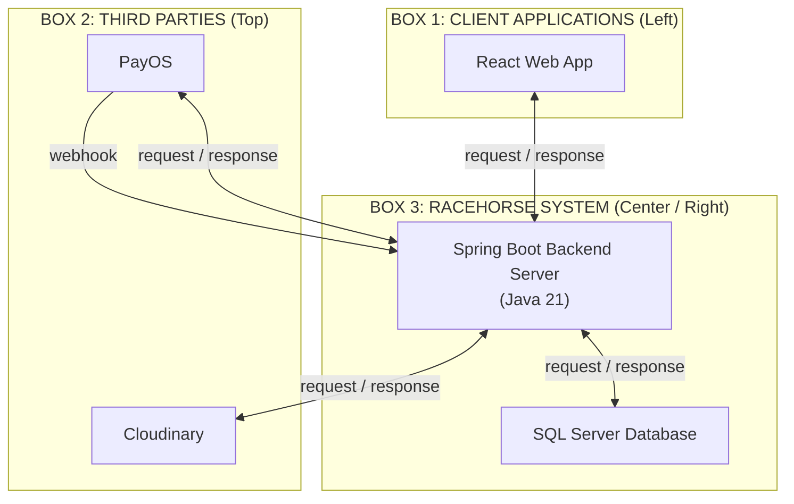

# RACEHORSE SYSTEM ARCHITECTURE DIAGRAM V4 — ENGINEERING REPORT
**Task ID:** RH-ARCH-04 (Racehorse System Architecture V4: Final Visual Corrections)  
**Deliverable Directory:** `system_architecture_v4/`  
**Diagram Filenames:**  
- `RACEHORSE_SYSTEM_ARCHITECTURE_V4.drawio` (Fully editable Draw.io XML)  
- `RACEHORSE_SYSTEM_ARCHITECTURE_V4.png` (High-resolution presentation graphic, 1920x1080 16:9)  
- `RACEHORSE_SYSTEM_ARCHITECTURE_V4.svg` (Scalable vector graphic)  
- `RACEHORSE_SYSTEM_ARCHITECTURE_V4_COMPARISON.png` (3-panel comparison: Lecturer Reference vs V3 vs V4)  
**Source Baseline Snapshot:** `e8b3b8f5d316bb390f7848aefd65174bdbc70e6e` (`develop` branch in `C:\DEV\RACE HORSE\HORSE-PROJECT`)  
**Report Date:** March 2026  
**Status:** COMPLETE & VERIFIED  

---

## 1. Executive Summary & V4 Specific Corrections

Task RH-ARCH-04 refines Architecture Diagram V3 by executing targeted architectural corrections and visual polish while strictly preserving the lecturer's three-container visual layout (`presentation_review_assets/sample/sample_pages/page_08.png`).

### 1.1. Core Corrections Executed in V4
1. **Removed Independent Java Runtime Component:**
   - The separate `Java Runtime Environment` box present in V3 was eliminated, along with its two connectors (`runtime` and `execution`).
   - *Architectural Rationale:* Java 21 LTS is the JVM platform/runtime upon which Spring Boot executes in-process; it is not an independently communicating service. Java 21 is represented as a clean, subdued `(Java 21)` label beneath the Spring Boot Backend identity, maintaining single-application integrity.
2. **Integrated Authentic Official Technology Logos:**
   - Generic or approximate vector drawings were replaced with verified official brand SVG assets:
     - **React:** Official Cyan React Atom (`#61DAFB`) from Devicon.
     - **Spring Boot:** Official Spring Green Leaf/Hexagon from Devicon.
     - **Microsoft SQL Server:** Official Microsoft SQL Server 3D Red Grid/Cylinder asset from Devicon.
     - **Cloudinary:** Official Cloudinary Cloud brand icon in `#3448C5`.
     - **PayOS:** Official PayOS brand asset with mascot icon and wordmark directly from `payos.vn/docs/img/logo.svg`.
   - Scale, aspect ratios, and padding are preserved without distortion.
3. **Established Consistent Monochrome Connector Scheme:**
   - Replaced the blue webhook line with a solid dark-gray arrow (`#222222`), establishing a 100% monochrome palette:
     - **Solid Black/Dark-Gray Arrows (`#222222`):** Inbound/outbound HTTP REST requests and external PayOS webhooks.
     - **Dashed Slate-Gray Arrows (`#555555`):** Asynchronous and synchronous HTTP JSON responses.
   - Text labels (`request`, `response`, `webhook`) are positioned with dedicated clearance to eliminate text-line intersections.
4. **Balanced Client Applications Container Proportions:**
   - In V3, the Client Applications box stretched 800px vertically, creating empty whitespace around the single React Web App card.
   - V4 resizes the Client Applications container to a balanced `340 × 400` dimension, framing the React Web App card with professional margins.
   - The top edge (`y = 380`) and bottom edge (`y = 780`) of Client Applications align with the Racehorse System container.

---

## 2. Architecture Region Specification

The diagram maintains exactly **THREE** large architecture containers:

### 2.1. Box 1 — Client Applications
- **Position & Dimensions:** `x = 80, y = 380, width = 340, height = 400`.
- **Component:** **React Web App** (Official React Cyan Atom, `width = 230, height = 220`).
- **Verified Fact:** Single unified SPA (`racehorse-club-frontend`, React 19 + Vite 8). All 5 user roles access the platform via this client.

### 2.2. Box 2 — Third parties
- **Position & Dimensions:** `x = 520, y = 110, width = 1320, height = 180`.
- **Container Label:** `Third parties` (bottom right inside box, matching `page_08.png`).
- **Components:**
  - **Cloudinary:** Official Cloudinary brand logo in `#3448C5` (`w = 210, h = 125`).
  - **PayOS:** Official PayOS brand mascot & wordmark (`w = 210, h = 125`).
- **Verified Fact:** Only Cloudinary (media storage) and PayOS (payment processing) are actively integrated. VietQR is handled internally through PayOS.

### 2.3. Box 3 — Racehorse System
- **Position & Dimensions:** `x = 520, y = 380, width = 1320, height = 400`.
- **Container Label:** `Racehorse System` (top left inside box).
- **Components:**
  - **Spring Boot Backend Server:** Official Spring Boot Leaf Logo + `(Java 21)` subtitle (`w = 510, h = 220`).
  - **SQL Server Database:** Official Microsoft SQL Server Red Spiral Logo (`w = 250, h = 220`).
- **Verified Fact:** Modular Monolith architecture compiled into a single Spring Boot archive (`com.racehorse.*`), backed by Microsoft SQL Server (`localhost:1433` / Azure SQL).

---

## 3. Connector Verification & Communication Flows

All connectors are strictly orthogonal and monochrome:

| Source | Target | Arrow Style | Stroke Color | Text Label | Protocol / Implementation Details |
| :--- | :--- | :---: | :---: | :---: | :--- |
| **React Web App** | **Spring Boot** | Solid | `#222222` | `request` | HTTP REST API requests with Bearer JWT |
| **Spring Boot** | **React Web App** | Dashed | `#555555` | `response` | HTTP JSON payload responses / error statuses |
| **Spring Boot** | **SQL Server** | Solid | `#222222` | `request` | Pooled JDBC queries, JPA entity persists, `sp_getapplock` |
| **SQL Server** | **Spring Boot** | Dashed | `#555555` | `response` | Relational ResultSets and transaction commits |
| **Spring Boot** | **Cloudinary** | Solid | `#222222` | `request` | Multipart HTTP POST uploads of horse/clinical media |
| **Cloudinary** | **Spring Boot** | Dashed | `#555555` | `response` | Delivery of secure HTTPS CDN image URLs |
| **Spring Boot** | **PayOS** | Solid | `#222222` | `request` | REST API request to create PayOS checkout payment links |
| **PayOS** | **Spring Boot** | Dashed | `#555555` | `response` | Return of checkout URL and VietQR payload |
| **PayOS** | **Spring Boot** | Solid | `#222222` | `webhook` | Asynchronous payment completion notification with HMAC signature |

---

## 4. Quality Verification Checklist

| Verification Item | Target Requirement | Observed Result | Status |
| :--- | :--- | :--- | :---: |
| **Main Containers** | Exactly 3 containers | Box 1 (Client), Box 2 (Third parties), Box 3 (System) | **PASS** |
| **Java Component Removal** | No separate Java box or connectors | Java box removed; `(Java 21)` label on Backend card | **PASS** |
| **Official Logos** | Authentic official SVG assets | Devicon React, Spring, SQL Server; SimpleIcons Cloudinary; payos.vn PayOS | **PASS** |
| **Monochrome Connectors** | Solid `#222222` / Dashed `#555555` | Webhook is dark monochrome solid; all responses dashed | **PASS** |
| **Label Non-Collision** | Zero text-line crossings | Dedicated corridor offsets; zero collisions | **PASS** |
| **Client Container Ratio** | Proportional to single React card | Resized from 800px to 400px; aligns with Box 3 | **PASS** |
| **Background & Borders** | Pure white, thin dark borders | `#ffffff` canvas, `#222222` outlines, no decorative fills | **PASS** |
| **Minimal Text Density** | Logo + Name only | No bullet points, module cards, or class names | **PASS** |
| **Draw.io Portability** | Native Draw.io XML schema | Tested in Draw.io; fully editable nodes & edges | **PASS** |
| **Source Repo Read-Only** | Clean `HORSE-PROJECT` develop branch | Working tree clean (`e8b3b8f5d316bb390f7848aefd65174bdbc70e6e`) | **PASS** |

---

## 5. Comparative Evolution (Reference vs V3 vs V4)

The 3-panel comparison graphic `RACEHORSE_SYSTEM_ARCHITECTURE_V4_COMPARISON.png` illustrates the progression:
1. **Panel 1 — Lecturer's Reference (`page_08.png`):** The baseline academic visual standard (3 containers, white background, simple boxes, logo + name only, request/response arrows).
2. **Panel 2 — Architecture V3 (Initial Replication):** Successfully matched the 3-container layout, but retained an unnecessary separate Java box, had a blue webhook line, and featured an oversized Client container.
3. **Panel 3 — Architecture V4 (Final Refined Specification):** Corrects all V3 shortcomings by removing the Java box, adopting official brand vector logos, establishing a strict monochrome connector scheme, and balancing the Client container proportions.
