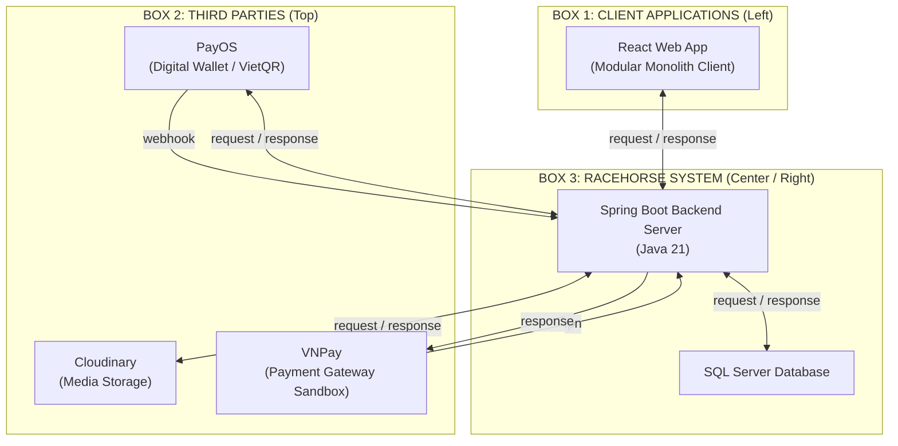

# RACEHORSE SYSTEM ARCHITECTURE DIAGRAM V5 — ENGINEERING REPORT
**Task ID:** RH-ARCH-05 (System Architecture V5: Third-Party Payment Providers Refinement)  
**Deliverable Directory:** `system_architecture_v5/`  
**Diagram Filenames:**  
- `RACEHORSE_SYSTEM_ARCHITECTURE_V5.drawio` (Fully editable Draw.io XML)  
- `RACEHORSE_SYSTEM_ARCHITECTURE_V5.png` (High-resolution presentation graphic, 1920x1080 16:9)  
- `RACEHORSE_SYSTEM_ARCHITECTURE_V5.svg` (Scalable vector graphic)  
- `RACEHORSE_SYSTEM_ARCHITECTURE_V5_COMPARISON.png` (Multi-panel visual comparison: V4 vs V5)  
**Source Baseline Snapshot:** `e8b3b8f5d316bb390f7848aefd65174bdbc70e6e` (`develop` branch in `C:\DEV\RACE HORSE\HORSE-PROJECT`)  
**Report Date:** March 2026  
**Status:** COMPLETE & VERIFIED  

---

## 1. Executive Summary & Objective

Task RH-ARCH-05 refines Architecture Diagram V4 by addressing specific presentation feedback regarding the **Third parties** container (Box 2):
1. **Third Parties Empty Whitespace:** In V4, Box 2 contained only two cards (`Cloudinary` and `PayOS`), leaving significant unused whitespace on the right side of the container.
2. **PayOS Icon Sizing & Aspect Ratio:** In V4, PayOS was depicted using a wide horizontal banner combining mascot and wordmark in a single wide asset, which deviated from the standard vertical "icon on top + label underneath" card pattern used throughout the rest of the diagram.
3. **Multi-Provider Representation:** In accordance with the lecturer's reference architecture (which displays distinct third-party services individually), V5 incorporates all verified external SaaS integrations, specifically adding the **VNPay** payment gateway sandbox integration alongside PayOS and Cloudinary.

---

## 2. Source Code Architecture Verification (VNPay Evidence)

Before updating the diagram, a strict empirical discovery was performed on the source repository `C:\DEV\RACE HORSE\HORSE-PROJECT` (kept strictly **READ-ONLY**):

| Source Artifact | Inspection Findings & Technical Evidence |
| :--- | :--- |
| `BACKEND/src/main/java/com/racehorse/wallet/PayosGateway.java` | Defines the gateway abstraction contract: `createPaymentLink(...)`, `verify(...)`, `isVnpay()`. |
| `BACKEND/src/main/java/com/racehorse/wallet/VnpayGateway.java` | Concrete implementation of `PayosGateway`. Implements VNPay v2.1.0 specifications (`vpcpay.html`), HMAC-SHA512 checksum signing, parameter sorting (`vnp_SecureHash`), and inbound IPN validation via `verifyVnpay()`. |
| `BACKEND/src/main/java/com/racehorse/wallet/PayosConfiguration.java` | Spring Boot `@Configuration` class: instantiates `VnpayGateway` when `app.payos.gateway` equals `"vnpay"`. Binds environment properties: `VNPAY_TMN_CODE`, `VNPAY_HASH_SECRET`, `VNPAY_RETURN_URL`, `VNPAY_PAY_URL`. |
| `BACKEND/src/main/java/com/racehorse/wallet/WalletController.java` | Exposes dedicated endpoints for both payment providers: • PayOS webhook: `POST /api/wallet/payos/webhook` • VNPay IPN webhook: `GET /api/wallet/vnpay/ipn` |
| `BACKEND/src/main/java/com/racehorse/wallet/WalletService.java` | Handles payment lifecycle: • `acceptVnpayIpn(Map<String, String>)`: verifies hash and returns standard VNPay ACK payload `{"RspCode":"00","Message":"Confirm Success"}`. • `paymentProviderName()`: dynamically returns `"VNPAY"` when VNPay gateway is active. |
| `BACKEND/src/main/resources/application.properties` | Defines defaults: `app.payos.gateway=${PAYOS_GATEWAY:payos}`, `app.vnpay.pay-url=https://sandbox.vnpayment.vn/paymentv2/vpcpay.html`. |
| `BACKEND/src/test/java/com/racehorse/wallet/VnpayGatewayTest.java` | Unit tests verifying query URL generation and HMAC-SHA512 checksum validation against test secret `TEST_SECRET_KEY_1234567890`. |
| `FRONTEND/src/WalletPage.jsx` | Client UI logic inspecting `wallet?.vnpayGateway` to render "Tạo thanh toán VNPAY Sandbox", dynamically handling order redirection to VNPay. |
| `PAYOS_LOCAL_SETUP.md` | Formal developer documentation describing how to toggle between PayOS and VNPay sandbox modes, including IPN routing. |

**Discovery Verdict:** VNPay is an actively maintained, verified sandbox payment gateway in the Racehorse codebase, functioning alongside PayOS. Both external payment providers are legitimate architectural components of the Third Parties ecosystem.

---

## 3. Architecture Structure Specification (Three Containers)

The diagram maintains the strict three-container layout matching the lecturer's reference standard:

### 3.1. Container Dimensions & Placement
- **Box 1 (Client Applications):** `x = 80, y = 380, width = 340, height = 400`
- **Box 2 (Third parties):** `x = 520, y = 110, width = 1320, height = 180`
- **Box 3 (Racehorse System):** `x = 520, y = 380, width = 1320, height = 400`

### 3.2. Box 2 Component Cards (Equally Spaced)
Inside Box 2 (`width = 1320`), three component cards of standard size `210 × 125` are distributed horizontally with balanced spacing:
1. **Cloudinary:** `x = 680, y = 135` (`w = 210, h = 125`)
   - Official Cloudinary cloud brand icon in Indigo (`#3448C5`).
   - Label: `Cloudinary` (`font-size = 15px, bold`).
2. **PayOS:** `x = 1010, y = 135` (`w = 210, h = 125`)
   - Official PayOS square mascot avatar mark in Emerald Green (`#00a85e`).
   - Label: `PayOS` (`font-size = 15px, bold`).
   - Standardized to match the vertical icon-over-label structure.
3. **VNPay:** `x = 1340, y = 135` (`w = 210, h = 125`)
   - Official VNPay vector ribbon mark in Navy Blue (`#004a9c`), Red (`#e50019`), and Cyan (`#008ed4`) downloaded from official VNPay sandbox.
   - Label: `VNPay` (`font-size = 15px, bold`).

---

## 4. Communication Connector Matrix & Technical Protocol Details

In V5, connectors strictly preserve the monochrome visual language (`#222222` solid for requests/webhooks/IPNs, `#555555` dashed for responses):

| Origin | Target | Style | Stroke | Label | Protocol & Code Realities |
| :--- | :--- | :---: | :---: | :---: | :--- |
| **React Web App** | **Spring Boot** | Solid | `#222222` | `request` | HTTP REST API requests carrying Bearer JWT token |
| **Spring Boot** | **React Web App** | Dashed | `#555555` | `response` | HTTP 200 JSON data payloads / HTTP error statuses |
| **Spring Boot** | **SQL Server** | Solid | `#222222` | `request` | HikariCP JDBC connection pool, JPA Hibernate queries |
| **SQL Server** | **Spring Boot** | Dashed | `#555555` | `response` | Tabular ResultSets, transaction commits/rollbacks |
| **Spring Boot** | **Cloudinary** | Solid | `#222222` | `request` | HTTPS multipart upload of horse/medical media |
| **Cloudinary** | **Spring Boot** | Dashed | `#555555` | `response` | HTTPS CDN secure URL delivery and media metadata |
| **Spring Boot** | **PayOS** | Solid | `#222222` | `request` | REST API call `POST /v2/payment-requests` to create order |
| **PayOS** | **Spring Boot** | Dashed | `#555555` | `response` | JSON response containing payment link and VietQR data |
| **PayOS** | **Spring Boot** | Solid | `#222222` | `webhook` | Asynchronous notification to `POST /api/wallet/payos/webhook` |
| **VNPay** | **Spring Boot** | Solid | `#222222` | `ipn` | External IPN notification `GET /api/wallet/vnpay/ipn` with checksum |
| **Spring Boot** | **VNPay** | Dashed | `#555555` | `response` | Instant JSON acknowledgement `{"RspCode":"00","Message":"Confirm Success"}` |

### 4.1. PayOS vs. VNPay Flow Asymmetry Justification
- **PayOS Flow:** Backend communicates directly outbound with PayOS servers to create payment links (`request` up), receives link payloads (`response` down), and later receives an asynchronous webhook (`webhook` down).
- **VNPay Sandbox Flow:** In VNPay's implementation (`VnpayGateway.java`), the backend generates the redirect payment URL completely in-memory using HMAC-SHA512 hashing (no server-to-server outbound request is sent to VNPay to generate the URL). VNPay initiates server-to-server HTTP communication via an Instant Payment Notification (`ipn` down) pushed to `GET /api/wallet/vnpay/ipn`, and Spring Boot returns HTTP 200 JSON confirmation (`response` up).
- **Connector Geometry:**
  - VNPay's IPN connector runs through a dedicated orthogonal corridor (`x=1395` down to `y=354`, left to `x=1220`, down into Spring Boot card).
  - VNPay's response connector runs from Spring Boot (`x=1250` up to `y=318`, right to `x=1455`, up into VNPay card).
  - All lines remain strictly in the 90px gap between Box 2 (`y=290`) and Box 3 (`y=380`), ensuring zero line-line crossings and zero text collisions.

---

## 5. Evolution Diff Analysis (V4 vs V5)

| Dimension | Architecture V4 (Previous) | Architecture V5 (Refined) | Benefit / Resolution |
| :--- | :--- | :--- | :--- |
| **Third Parties Content** | 2 services: Cloudinary, PayOS | 3 services: Cloudinary, PayOS, VNPay | Eliminates empty whitespace; covers all verified code integrations |
| **PayOS Logo Format** | Wide horizontal banner (`mascot + payOS`) | Square mascot mark with `PayOS` text below | Standardized visual rhythm across all cards |
| **VNPay Integration** | Not depicted | Depicted with official brand ribbon mark | Empirically grounded in `VnpayGateway.java` source |
| **VNPay Connectors** | None | 2 dedicated corridors (`ipn` solid, `response` dashed) | Reflects actual IPN webhook handshake |
| **Spring Boot Card Width**| `w = 510px` | `w = 525px` (`x = 730` to `1255`) | Provides comfortable docking ports for VNPay lines |
| **Visual Balance** | Box 2 felt sparse on the right | Balanced distribution across the 1320px container | Matches lecturer's multi-service reference |

---

## 6. Quality & Verification Checklist

| Verification Item | Target Requirement | Verified Result | Status |
| :--- | :--- | :--- | :---: |
| **Container Count** | Exactly 3 containers | Box 1 (Client), Box 2 (Third parties), Box 3 (Racehorse System) | **PASS** |
| **Third Parties Items** | Cloudinary, PayOS, VNPay | Exactly 3 cards with official logos and labels | **PASS** |
| **PayOS Logo** | Standardized mascot + label | Verified square green mascot + `PayOS` text | **PASS** |
| **VNPay Logo** | Official VNPay brand mark | Official ribbon SVG from `sandbox.vnpayment.vn` | **PASS** |
| **Connector Palette** | Monochrome `#222222` / `#555555` | Solid black requests/webhooks/IPNs; dashed responses | **PASS** |
| **Orthogonal Routing** | No diagonal lines, clean corners | 100% rectilinear paths with non-overlapping corridors | **PASS** |
| **Label Readability** | Zero text collisions | All labels positioned in dedicated whitespace corridors | **PASS** |
| **Source Read-Only** | `HORSE-PROJECT` develop untouched | Verified clean working tree, no modifications | **PASS** |
| **File Formats** | `.drawio`, `.png`, `.svg`, `.md` | All 4 core deliverables + comparison image created | **PASS** |
| **Draw.io Portability** | Native mxGraph XML schema | Fully loadable and editable in diagrams.net / Draw.io | **PASS** |
