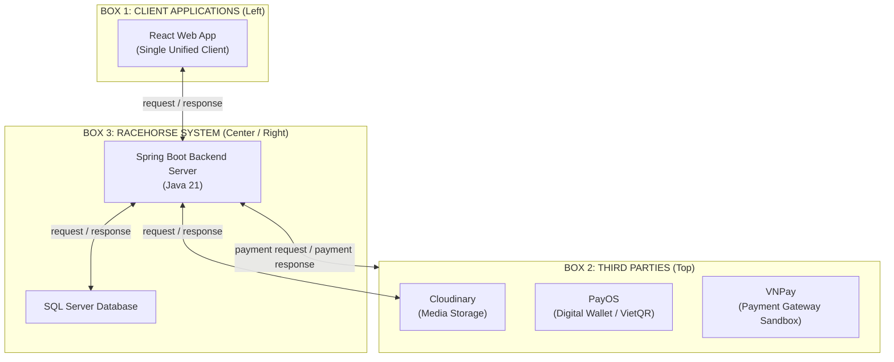

# RACEHORSE SYSTEM ARCHITECTURE DIAGRAM V6 — ENGINEERING REPORT
**Task ID:** RH-ARCH-06 (Racehorse System Architecture V6: Shared Third-Party Payment Connection)  
**Deliverable Directory:** `system_architecture_v6/`  
**Diagram Filenames:**  
- `RACEHORSE_SYSTEM_ARCHITECTURE_V6.drawio` (Fully editable Draw.io XML)  
- `RACEHORSE_SYSTEM_ARCHITECTURE_V6.png` (High-resolution presentation graphic, 1920x1080 16:9)  
- `RACEHORSE_SYSTEM_ARCHITECTURE_V6.svg` (Scalable vector graphic)  
- `RACEHORSE_SYSTEM_ARCHITECTURE_V6_COMPARISON.png` (Multi-panel visual comparison: V5 vs V6)  
**Source Baseline Snapshot:** `e8b3b8f5d316bb390f7848aefd65174bdbc70e6e` (`develop` branch in `C:\DEV\RACE HORSE\HORSE-PROJECT`)  
**Report Date:** March 2026  
**Status:** COMPLETE & VERIFIED  

---

## 1. Executive Summary & Objective

Task RH-ARCH-06 refines Architecture Diagram V5 to more faithfully replicate the visual structure and information abstraction of the lecturer's reference architecture (`presentation_review_assets/sample/sample_pages/page_08.png`).

### Core Refinements Executed in V6:
1. **Removal of Nested Provider Boxes in Third Parties:**
   - In V5, each external service (`Cloudinary`, `PayOS`, and `VNPay`) was enclosed inside an individual rectangular card border (`210 × 125`), introducing visual clutter that deviated from the lecturer's sample.
   - In V6, all individual bounding boxes inside Box 2 are removed. The three verified official brand logos and their labels sit directly on the clean white surface of the shared `Third parties` container, matching the reference diagram's visual treatment.
2. **Presentation-Level Shared Payment Connection:**
   - In V5, PayOS and VNPay were drawn with separate connectors (3 vertical lines for PayOS and 2 orthogonal lines for VNPay), causing dense connector routing in the inter-container space.
   - In V6, PayOS and VNPay are logically grouped at the presentation architecture level. They share **ONE logical request/response connection pair** connecting Spring Boot Backend directly to the outer boundary of the `Third parties` container:
     - `payment request` (solid dark-gray `#222222` arrow pointing UP to container boundary)
     - `payment response` (dashed slate-gray `#555555` arrow pointing DOWN to Backend)
3. **Preservation of Independent Cloudinary Connector:**
   - Cloudinary (media asset storage) remains an independent SaaS provider with its own dedicated `request` and `response` vertical connector pair.
4. **No Misleading Topology:**
   - No lines connect PayOS to VNPay or vice-versa. The diagram does NOT imply failover, forwarding, or simultaneous multi-gateway transactions.

---

## 2. Technical Evidence & Architecture Realities

### 2.1. Empirical Source Evidence from `HORSE-PROJECT` (READ-ONLY)
The underlying code in `C:\DEV\RACE HORSE\HORSE-PROJECT` confirms the following architectural facts:

| Source Artifact | Architectural Reality |
| :--- | :--- |
| `BACKEND/.../wallet/PayosGateway.java` | Common interface defining `createPaymentLink(...)`, `verify(...)`, `isVnpay()`. |
| `BACKEND/.../wallet/VnpayGateway.java` | Alternative implementation generating signed redirect URLs (`https://sandbox.vnpayment.vn/paymentv2/vpcpay.html`) using HMAC-SHA512. |
| `BACKEND/.../wallet/PayosConfiguration.java` | Configuration switch: instantiates either PayOS or VNPay based on `app.payos.gateway` (`${PAYOS_GATEWAY:payos}`). |
| `BACKEND/.../wallet/WalletController.java` | Houses both webhook endpoints: `POST /api/wallet/payos/webhook` and `GET /api/wallet/vnpay/ipn`. |
| `BACKEND/.../wallet/WalletService.java` | Resolves active provider dynamically (`paymentProviderName()`), processing transactions according to the selected gateway. |
| `FRONTEND/src/WalletPage.jsx` | UI dynamically toggles between PayOS VietQR flow and VNPay sandbox redirect based on backend capabilities (`wallet?.vnpayGateway`). |

### 2.2. Architectural Justification of Presentation-Level Grouping
- **Alternative Integrations:** The application runs with **one active gateway at a time** depending on environment configuration (`PAYOS_GATEWAY=payos` or `PAYOS_GATEWAY=vnpay`).
- **No Simultaneous Execution:** A payment transaction never flows through both providers simultaneously.
- **Abstraction Integrity:** Representing the payment subsystem as a grouped external capability (`payment request` / `payment response`) connected to the Third Parties container accurately models the architectural capability of the platform while eliminating connector noise.
- **Callback/IPN Handling:** The individual asynchronous callbacks (`POST /api/wallet/payos/webhook` and `GET /api/wallet/vnpay/ipn`) operate as secondary inbound notifications. In accordance with task instructions and academic presentation design standards, these callbacks are abstracted out of the high-level diagram and documented here in this engineering report.

---

## 3. Visual Layout Specification (Three Main Containers)

The diagram strictly maintains the three-container layout:

### 3.1. Container Geometries
- **Box 1 (Client Applications):** `x = 80, y = 380, width = 340, height = 400`
- **Box 2 (Third parties):** `x = 520, y = 110, width = 1320, height = 180`
  - Bottom boundary line at `y = 290`.
  - Subdued container label: `Third parties` at `x = 1810, y = 268` (`fill="#444444"`).
- **Box 3 (Racehorse System):** `x = 520, y = 380, width = 1320, height = 400`

### 3.2. Third Parties Surface Placement (No Nested Rectangles)
Inside Box 2, services are positioned with balanced horizontal distribution:
1. **Cloudinary:** Center `x = 780`
   - Official Cloudinary SVG cloud mark (`#3448C5`, `56 × 56`) at `y = 152`.
   - Name label: `Cloudinary` at `y = 235` (`font-size = 16px, bold, #111111`).
2. **PayOS:** Center `x = 1140`
   - Official PayOS square mascot mark (`#00a85e`, `56 × 56`) at `y = 152`.
   - Name label: `PayOS` at `y = 235` (`font-size = 16px, bold, #111111`).
3. **VNPay:** Center `x = 1500`
   - Official VNPay ribbon vector mark (`#004a9c`, `#e50019`, `#008ed4`, `62 × 48`) at `y = 156`.
   - Name label: `VNPay` at `y = 235` (`font-size = 16px, bold, #111111`).

---

## 4. Communication Connector Matrix & Routing

All connectors are strictly monochrome and orthogonal, terminating on container boundaries or component cards:

| Origin | Target | Style | Stroke Color | Text Label | Protocol / Implementation Details |
| :--- | :--- | :---: | :---: | :---: | :--- |
| **React Web App** | **Spring Boot** | Solid | `#222222` | `request` | HTTP REST API requests with Bearer JWT (`port 8080`) |
| **Spring Boot** | **React Web App** | Dashed | `#555555` | `response` | HTTP 200 JSON payloads / error responses |
| **Spring Boot** | **SQL Server** | Solid | `#222222` | `request` | HikariCP JDBC connection pool, JPA entity queries |
| **SQL Server** | **Spring Boot** | Dashed | `#555555` | `response` | ResultSets, transactional commits/rollbacks |
| **Spring Boot** | **Third Parties (Cloudinary)** | Solid | `#222222` | `request` | HTTPS multipart upload of horse/medical media (`x = 750`) |
| **Third Parties (Cloudinary)** | **Spring Boot** | Dashed | `#555555` | `response` | Secure CDN HTTPS image URLs delivery (`x = 810`) |
| **Spring Boot** | **Third Parties (Payment)** | Solid | `#222222` | `payment request` | Abstracted outbound payment initialization (`x = 1070`) |
| **Third Parties (Payment)** | **Spring Boot** | Dashed | `#555555` | `payment response` | Abstracted return of checkout URL / QR payload (`x = 1170`) |

### 4.1. Inter-Container Clearance & Non-Crossing Geometry
- Gap between Box 2 bottom (`y = 290`) and Box 3 top (`y = 380`) is 90px.
- Spring Boot Backend card is positioned at `y = 470`.
- All vertical connectors run straight between `y = 290` and `y = 470`.
- Vertical connector labels (`request`, `response`, `payment request`, `payment response`) are positioned at `y = 335` with `dominant-baseline="middle"`.
- This ensures labels sit in the open whitespace of the 90px gap, touching NO horizontal container borders and NO component card outlines.

---

## 5. Comparative Evolution (V5 vs V6)

| Feature / Element | Architecture V5 (Baseline) | Architecture V6 (Refined) | Rationale & Academic Fit |
| :--- | :--- | :--- | :--- |
| **Provider Cards in Box 2** | Enclosed in individual boxes (`210 × 125`) | Borderless; logos & text sit on container surface | Directly matches lecturer's reference layout (`page_08.png`) |
| **Payment Connectors** | 5 separate lines (PayOS req/res/webhook + VNPay ipn/res) | 1 shared logical pair (`payment request` / `payment response`) | Groups alternative payment gateways under a clean abstraction |
| **Connector Terminations** | Connected to individual provider cards | Connected to the outer boundary of Third Parties | Avoids routing through logos; follows reference style |
| **Cloudinary Connection** | Independent vertical lines | Retained as independent vertical lines | Media storage remains an independent functional concern |
| **Visual Density** | High connector density in inter-container gap | Clean, minimalist, and presentation-ready | Maximizes clarity for presentation slides and reviews |

---

## 6. Quality & Verification Checklist

| Verification Item | Target Requirement | Verified Result | Status |
| :--- | :--- | :--- | :---: |
| **Container Count** | Exactly 3 containers | Box 1 (Client), Box 2 (Third parties), Box 3 (System) | **PASS** |
| **No Individual Provider Boxes**| Borderless services inside Box 2 | Cloudinary, PayOS, VNPay have NO nested card boxes | **PASS** |
| **Shared Payment Connection** | Exactly 1 request/response pair | `payment request` (solid) and `payment response` (dashed) | **PASS** |
| **Independent Cloudinary** | Retains dedicated connection | `request` (solid) and `response` (dashed) to boundary | **PASS** |
| **Outer Boundary Termination** | Lines touch Box 2 outer border | Connected at `y = 290`, NOT to individual logo shapes | **PASS** |
| **No Misleading Topology** | No provider-to-provider lines | Zero lines between PayOS and VNPay; no forwarding | **PASS** |
| **Official Logos & Proportions**| Authentic SVG brand marks | Devicon React/Spring/SQL; official Cloudinary, PayOS, VNPay | **PASS** |
| **Monochrome Scheme** | Solid `#222222` / Dashed `#555555` | Strictly dark monochrome request/response scheme | **PASS** |
| **Label Non-Collision** | Zero text-line crossings | Labels at `y = 335` in open corridor; zero collisions | **PASS** |
| **Source Repo Read-Only** | Clean `HORSE-PROJECT` develop branch | Source repository strictly untouched and clean | **PASS** |
| **Draw.io Portability** | Native Draw.io XML format | Fully editable in Draw.io / diagrams.net | **PASS** |
